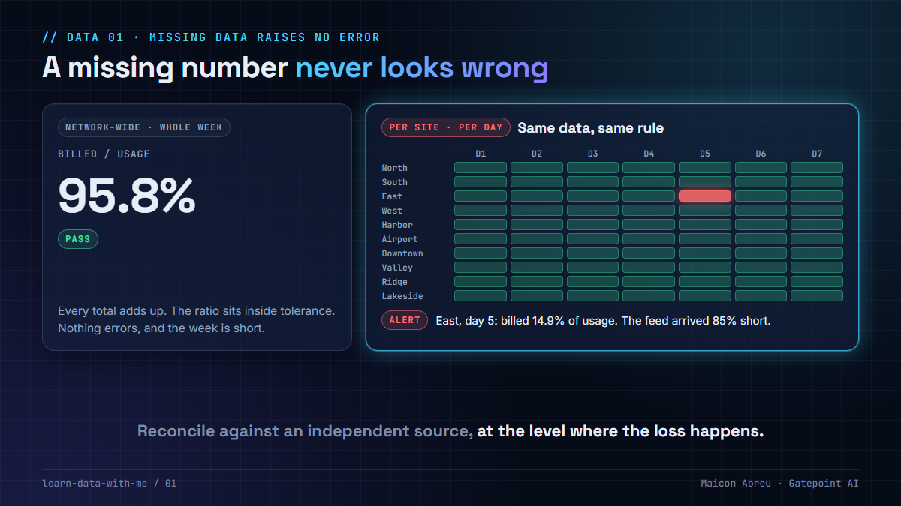

# 01 · Missing data raises no error

> **The idea:** a wrong number sometimes looks wrong. A missing number never does. The loader loads what arrived, every query runs, every total adds up, and it's all short. The only way to see a gap is to reconcile against an independent source, at the level where the loss happens.



## The problem

Pipelines are good at telling you about data that is *bad*: a parse error, a null in a required column, a type mismatch. They are silent about data that never came:

- a `COPY` of a file truncated upstream succeeds, with 15% of the rows;
- an upstream job that wrote zero rows exits 0, and the downstream job runs on schedule;
- an incremental load whose watermark has moved past a late partition skips it for good;
- an inner join between usage and billing drops the site-day that has no billing at all, so the gap leaves the report instead of showing up in it.

Every one of these finishes green. The dashboard refreshes on time and shows a number that is plausible and short.

## What I saw

My first job in this field, in 2006, was checking whether telecom calls had actually been billed. I spent the next 20 years in revenue assurance, and the expensive problems were rarely numbers that were wrong. They were records that went missing between two systems: carried by the network, never charged.

The control that finds them is always the same shape. Take two **independent** records of the same events (what the network carried, what billing charged), and compare them at a fine enough level that one lost feed can't hide in the total.

The level matters as much as the source. I saw that again when I built [Argus](https://github.com/gatepoint-ai/learn-ai-with-me/tree/main/argus), my open-source revenue-assurance app. Its test data has four faults planted on purpose, one of them a site losing 85% of its volume for a day. **Network-wide KPIs caught one of the four**, because one site's loss barely moves the network total. Per-site rules caught all four.

## The decision

1. **Reconcile against an independent source.** A check that only reads the feed can't see what never arrived. Usage against billing, orders against invoices, source row counts against target row counts.
2. **Reconcile at the grain where the loss happens.** Feeds fail per source, per site, per day. Aggregate both sides to that grain and compare there, not only on the grand total.
3. **Use a `FULL OUTER JOIN`, not an inner join.** The rows that exist on only one side are the finding.
4. **Set a tolerance per level.** Small slices are noisier than big ones, so they need a wider band. Tune it on history: too tight and the alert gets muted, too loose and the real gap passes.
5. **Test completeness explicitly.** Keep a table of the feeds or partitions you expect each day and anti-join it against what landed. Missing is a state you have to test for.

## The check in SQL

Both sides at one row per site per day, then compared. Runs as written on PostgreSQL, DuckDB and SQLite:

```sql
WITH u AS (SELECT site, day, SUM(amount) AS usage_amt  FROM usage  GROUP BY site, day),
     b AS (SELECT site, day, SUM(amount) AS billed_amt FROM billed GROUP BY site, day)
SELECT COALESCE(u.site, b.site)  AS site,
       COALESCE(u.day,  b.day)   AS day,
       COALESCE(u.usage_amt, 0)  AS usage_amt,
       COALESCE(b.billed_amt, 0) AS billed_amt
FROM u
FULL OUTER JOIN b ON b.site = u.site AND b.day = u.day
WHERE COALESCE(b.billed_amt, 0) < 0.90 * COALESCE(u.usage_amt, 0)   -- under-billed, or not billed at all
   OR u.site IS NULL;                                                -- billed with no usage behind it
```

And the completeness check, against a table of what should have arrived:

```sql
SELECT e.site, e.day
FROM expected_feeds e
LEFT JOIN (SELECT DISTINCT site, day FROM billed) l
       ON l.site = e.site AND l.day = e.day
WHERE l.site IS NULL;
```

In dbt, the first query becomes a model with a test on it, and the second is what [source freshness](https://docs.getdbt.com/docs/build/sources#source-data-freshness) does for a whole source. The [leakage pipeline](../leakage-pipeline/) builds both.

## The trade-off

| You gain | You pay |
|---|---|
| Detection the day the feed lands, not at month-end close | A second source to ingest, with its own latency and failures |
| An alert scoped to one feed and one day, so triage starts at the cause | Tolerances per level, tuned on history and revisited |
| The gap as an amount, not just a red light | An aggregation and a full outer join on every run |

## Try it

[`example/reconcile_usage_billing.py`](example/reconcile_usage_billing.py): Python, standard library only (`sqlite3`), made-up data, no installs.

```bash
cd example
python reconcile_usage_billing.py
```

Ten sites, seven days, usage against billing. On day 5, one site's billing feed delivers only 15% of its records. Nothing errors.

```
1) Network-wide, whole week (tolerance 95%)
   usage  22,445.07   billed  21,509.34   billed/usage 95.8%   -> PASS

2) Per site, per day (70 site-days, tolerance 90%)
   ALERT  East      day 5   usage  308.66   billed   45.88   billed/usage 14.9%   unbilled ~253.52
   69 site-days pass, 1 flagged.
```

Same data, same rule. The level you reconcile at decides whether the gap exists.

*Tested with Python 3.12.10 on Windows, 3 Nov 2026.*

## Common mistakes

- **Reconciling a system against itself.** Comparing the billing table to the billing report proves the report reads the table, nothing more.
- **Only checking totals.** One feed short and another double-counted can produce a perfect total.
- **One tolerance for every level.** The same 95% that works for the week will fire every day on a single site.
- **Treating "no alerts" as "no problems".** If no check ever fires, test the check: plant a known gap and make sure it's found.

## Go deeper

- [dbt: source freshness](https://docs.getdbt.com/docs/build/sources#source-data-freshness): alert when a source stops arriving.
- [dbt: data tests](https://docs.getdbt.com/docs/build/data-tests): the same idea as code, run on every build.
- [Google SRE book, Data Integrity](https://sre.google/sre-book/data-integrity/): why you can't trust data you haven't checked end to end.
- Related, in my AI lessons: [Verified means reconciled](https://github.com/gatepoint-ai/learn-ai-with-me/tree/main/11-verified-means-reconciled), the same habit applied to a 7.8 TB migration.

---

📣 LinkedIn post: 12 Nov 2026 · Next: [02 · Grain first](../02-grain-first/)
