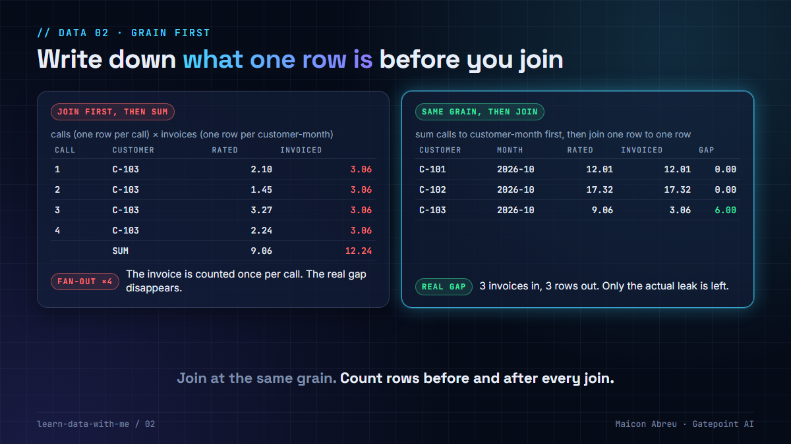

# 02 · Grain first

> **The idea:** before any join, any model, any dashboard, answer one question in writing: *what is one row?* Most wrong numbers in a warehouse don't come from bad data. They come from joining two tables that count different things.



## The problem

A join doesn't check whether the two sides describe the same thing. Join calls (one row per call) to invoices (one row per customer per month), sum both sides, and every invoice is counted once per call. The query runs, the numbers look like money, and nobody gets an error.

It's called fan-out: a one-to-many join repeats the "one" side once per match, and any additive measure on that side gets summed once per repeat. It scales with the data. A customer with three calls is over-counted three times, a customer with five calls five times. The real problem you were looking for gets buried under fake ones.

## What I saw

I worked for years with star schemas and aggregate tables behind revenue-assurance dashboards for telecom operators: fact tables of usage and billing, dimensions for customers, products and sites, and pre-computed rollups so the dashboards stayed fast.

The habit that keeps numbers like those honest is simple. Every fact table and every aggregate gets its **grain written down**: "one row per call", "one row per customer per month per product". Any join between two grains aggregates one side first, and any new aggregate is checked against the detail it came from.

## The decision

1. **Write the grain of every table** in its documentation, in one line. If you can't, the table isn't ready.
2. **Join at the same grain.** Aggregate the finer side up to the coarser one first (calls → customer-month), then join.
3. **Count rows before and after joins.** Decide which grain each sum belongs to. If the invoice total should be summed once per invoice and the join gives it twelve rows from three invoices, that's a fan-out.
4. **Test the grain.** A uniqueness test on the grain columns (`customer`, `month`) catches a duplicate the day it appears. dbt's built-in `unique` test covers a single column; for a grain of two or more columns, use `dbt_utils.unique_combination_of_columns`.

## The check in SQL

The grain test returns nothing when the table is at its declared grain. The fan-out check compares how many rows a sum was taken over with how many entities it should have been taken over:

```sql
-- Grain test: invoices are one row per customer per month.
SELECT customer, month, COUNT(*) AS n
FROM invoices
GROUP BY customer, month
HAVING COUNT(*) > 1;

-- Fan-out check: invoiced_total summed after this join is summed over rows_summed rows.
SELECT COUNT(*)                                     AS rows_summed,   -- 12 in the example
       COUNT(DISTINCT i.customer || '|' || i.month) AS invoices       -- 3
FROM calls c
JOIN invoices i ON i.customer = c.customer AND i.month = c.month;
```

In dbt, the grain goes in the model's description and becomes a test that runs on every build:

```yaml
models:
  - name: fct_invoice
    description: "Grain: one row per customer per invoice month."
    data_tests:
      - dbt_utils.unique_combination_of_columns:
          arguments:                  # dbt 1.10+; older versions put the argument one level up
            combination_of_columns: [customer_id, invoice_month]
```

## The trade-off

| You gain | You pay |
|---|---|
| Totals that reconcile to their source | An aggregation (a CTE or an intermediate model) before every cross-grain join |
| Fan-out caught by a failing test in CI, not by a finance analyst | Grain descriptions and uniqueness tests to maintain |
| Facts that any downstream model can join safely | Less freedom for one-off joins in the mart layer |

## Try it

[`example/grain_fanout.py`](example/grain_fanout.py): Python, standard library only (`sqlite3`), made-up data, no installs.

```bash
cd example
python grain_fanout.py
```

Three customers, one month. One of them was invoiced 6.00 less than it was rated.

```
1) Join first, then sum (call grain meets customer-month grain)
   C-101        12.01     36.03   -24.02   <- gap
   C-102        17.32     86.60   -69.28   <- gap
   C-103         9.06     12.24    -3.18   <- gap

2) Sum to the same grain first, then join
   C-101        12.01     12.01     0.00
   C-102        17.32     17.32     0.00
   C-103         9.06      3.06     6.00   <- gap

Check that would have caught it: invoiced_total was summed over 12 rows,
but there are only 3 invoices.
```

The wrong version flags everyone, and its smallest gap is the real leak.

*Tested with Python 3.12.10 on Windows, 3 Nov 2026.*

## Common mistakes

- **`SELECT DISTINCT` to make duplicates go away.** It hides the fan-out instead of fixing the grain, and it drops genuine duplicates too.
- **Averaging an average.** An aggregate table at customer-month can't be averaged up to region-month without the row counts behind it.
- **A dimension that isn't unique.** A customer with two "current" rows doubles every fact joined to it. Test uniqueness on the key.
- **Changing an aggregate's grain silently.** Add a column to the `GROUP BY` and every consumer's totals change.

## Go deeper

- [Kimball Group: Declare the grain](https://www.kimballgroup.com/data-warehouse-business-intelligence-resources/kimball-techniques/dimensional-modeling-techniques/grain/): the step dimensional modelling starts with.
- [dbt: data tests](https://docs.getdbt.com/docs/build/data-tests): `unique` and `not_null` on the grain columns.
- [dbt-utils on dbt Hub](https://hub.getdbt.com/dbt-labs/dbt_utils/latest/): `unique_combination_of_columns`, for grains of more than one column.
- [dbt Fundamentals](https://learn.getdbt.com/courses/dbt-fundamentals): the free course, models and tests from the start.

---

📣 LinkedIn post: 19 Nov 2026 · Previous: [01 · Missing data raises no error](../01-missing-data-raises-no-error/) · Next: [03 · Schedule beats tuning](../03-schedule-beats-tuning/)
