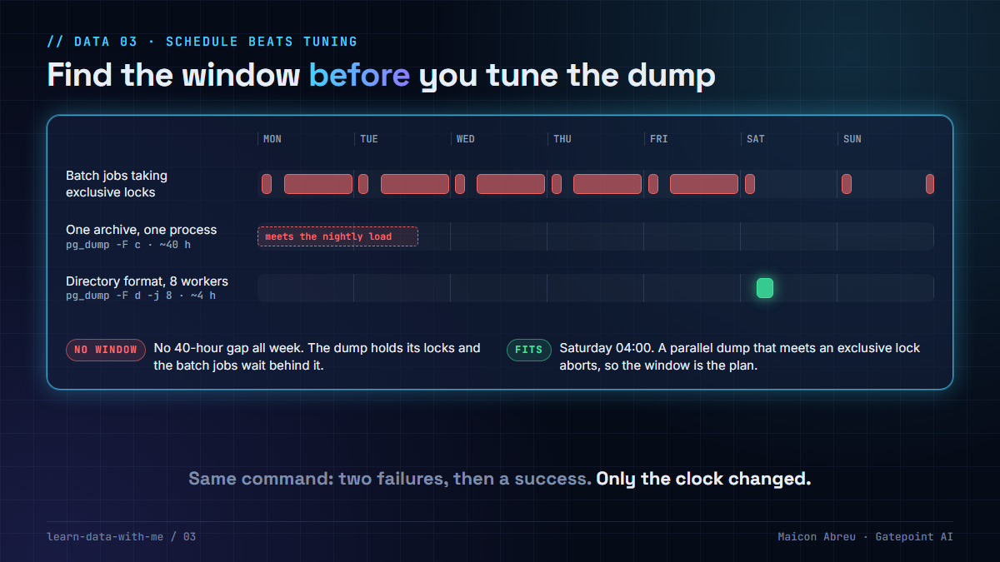

# 03 · Schedule beats tuning

> **The idea:** on a big database, making the dump faster is half the job. The other half is finding a window where nothing else needs the tables. A parallel dump that meets one batch job asking for an `ACCESS EXCLUSIVE` lock doesn't slow down. It aborts.



## The problem

Moving a large PostgreSQL database means dumping it, and the obvious way to speed that up is parallelism. Directory format is the only `pg_dump` format that supports it: `-F d -j 8` dumps eight tables at a time, each worker on its own connection. A custom-format archive (`-F c`) is written by one process.

How the locks work is what decides whether it finishes:

- At the start, `pg_dump` takes an `ACCESS SHARE` lock on every table it will dump and holds it until the end. That mode conflicts with only one other: `ACCESS EXCLUSIVE`, which `TRUNCATE`, `DROP`, most `ALTER TABLE` forms, `VACUUM FULL` and a non-concurrent `REFRESH MATERIALIZED VIEW` all take.
- A batch job that asks for `ACCESS EXCLUSIVE` mid-dump goes into the lock queue behind `pg_dump`.
- **In parallel mode,** each worker then asks for its own `ACCESS SHARE` lock with `NOWAIT`. It can't get it past the queued request, so `pg_dump` aborts. The [PostgreSQL documentation](https://www.postgresql.org/docs/current/app-pgdump.html) explains why: waiting could deadlock.
- **In single-process mode,** nothing aborts. The batch job waits for the whole dump, and every ordinary query on that table queues behind the waiting batch job.

So a faster dump can fail where a slower one wouldn't, and a slower one can stall production for hours. I reproduced both on PostgreSQL 16 for this lesson:

```
-F d -j 4, TRUNCATE requested mid-dump:
  pg_dump: error: could not obtain lock on relation "public.t11"
  This usually means that someone requested an ACCESS EXCLUSIVE lock on the table
  after the pg_dump parent process had gotten the initial ACCESS SHARE lock on the table.

-F c, same TRUNCATE:
  dump exit 0 after 12.5 s; the TRUNCATE waited 11.9 s;
  a plain SELECT on the same table, issued meanwhile, hit its lock_timeout
```

## What I did

I worked hands-on as the engineer on a ~7.8 TB PostgreSQL migration from Azure to Oracle Cloud for a European national postal operator.

- **First attempt:** a single compressed archive (`-F c -Z 9`). It took about 41 hours and then had to be discarded, because the target's import tooling only accepted directory format.
- **Second and third attempts:** `-F d -j 8`. Both aborted with `ACCESS EXCLUSIVE` lock errors. The client's own batch jobs were taking table-level locks on tables the dump needed.
- **Fourth attempt:** the same command, started **at the weekend, off-hours, by a systemd timer and service** on a dedicated backup VM. It completed with no lock errors.

```bash
pg_dump -h <source> -U <admin> -d <db> -F d -j 8 -b -v -f /mnt/pgbackup/<label>.backup
```

The timer solved a second problem too. Commands sent through the cloud CLI's remote `run-command` are non-interactive: a process started there dies when the call returns, and `tmux` wasn't available on that path. A systemd unit (or `systemd-run` for a one-off) detaches the job from whoever started it.

Nothing about the `pg_dump` command changed between the failures and the success. Only the clock did. The final cutover dump took about four hours.

## The decision

1. **Map the lock-taking jobs first.** Before tuning anything, find every job that takes `ACCESS EXCLUSIVE` on a table the dump needs, and when it runs. The query below, sampled every minute for a week, gives you the list.
2. **Turn on `log_lock_waits`.** Sampling misses short locks. With it on, PostgreSQL logs every wait longer than `deadlock_timeout` (1 s by default), with the blocking and waiting process IDs.
3. **Pick the window, then the strategy.** A faster dump only helps if there's a window longer than the dump.
4. **Fail fast if the window is wrong.** `--lock-wait-timeout=60s` makes `pg_dump` give up at the start if it can't get its locks, instead of joining a queue.
5. **Run it from a scheduler, not a session.** A systemd timer and service, cron, or an orchestrator. Not an SSH session or a remote-command call that ends before the job does.
6. **Agree the freeze with the data owner.** "No batch jobs between 04:00 and 08:00 on Saturday" is a decision someone has to own, not a database setting.

## Finding the lock takers in SQL

```sql
SELECT now() AS seen_at, a.usename, a.application_name,
       l.relation::regclass AS locked_table, l.granted, left(a.query, 60) AS query
FROM pg_locks l
JOIN pg_class c ON c.oid = l.relation
JOIN pg_stat_activity a ON a.pid = l.pid
WHERE l.mode = 'AccessExclusiveLock'
  AND l.database = (SELECT oid FROM pg_database WHERE datname = current_database())
  AND c.relkind IN ('r', 'p')          -- tables and partitioned tables
  AND c.relpersistence = 'p';          -- skip temp tables the jobs create for themselves
```

During the reproduction above, it caught the batch job waiting behind the dump: `nightly_load | t11 | granted = false | TRUNCATE t11`.

## The trade-off

| You gain | You pay |
|---|---|
| A dump that completes on its first run in the window | Off-hours runs, and someone watching them |
| No lock queue building up behind the dump for production sessions | Days of waiting for the next safe window |
| A timer-driven, repeatable cutover | A week of lock sampling before you can plan |

## Try it

[`example/dump_window.py`](example/dump_window.py): Python, standard library only, a made-up batch schedule, no installs.

```bash
cd example
python dump_window.py
```

It takes one week of jobs that lock tables and checks two strategies for a safe start time:

```
single archive, one process (-F c): ~40 h
   no safe start time this week. Starting Monday 00:00, it meets: nightly load at Mon 01:00
   and then the dump holds its locks, so the batch job waits behind it.

directory format, 8 workers (-F d -j 8): ~4 h
   62 safe start times this week. First: Sat 04:00 -> done Sat 08:00
```

*Tested with Python 3.12.10 on Windows, 3 Nov 2026.*

## Common mistakes

- **Tuning before scheduling.** More workers make a dump faster, but they can't make it survive one `ACCESS EXCLUSIVE` request.
- **Thinking the single-process dump is the safe one.** It doesn't abort, but it holds its locks for hours, and the queue behind them is production's.
- **Starting a multi-hour job from an interactive session or a remote-command call.** When the session ends, so does the job.
- **Grepping the log for "error" to decide if it worked.** It also matches table names. Use the exit code, then `pg_restore --list` and object counts.
- **Assuming the source is quiet because the application is.** Batch jobs, housekeeping and partition maintenance run whether or not users are online.

## Go deeper

- [PostgreSQL: pg_dump](https://www.postgresql.org/docs/current/app-pgdump.html): the directory format, `-j`, and the note on why a parallel dump aborts on a lock conflict.
- [PostgreSQL: Explicit locking](https://www.postgresql.org/docs/current/explicit-locking.html): which commands take which locks, and what conflicts with what.
- Related, in my AI lessons: [Verified means reconciled](https://github.com/gatepoint-ai/learn-ai-with-me/tree/main/11-verified-means-reconciled), how the same dump was checked object by object.

---

📣 LinkedIn post: 3 Dec 2026 · Previous: [02 · Grain first](../02-grain-first/) · Next: [04 · What restore doesn't restore](../04-what-restore-does-not-restore/)
