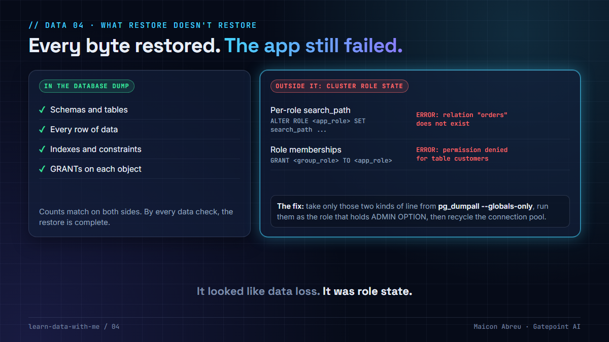

# 04 · What restore doesn't restore

> **The idea:** `pg_restore` brings back your tables, your data and the grants on each object. It does not bring back the role settings and role memberships the application depends on. After a migration, "relation does not exist" can mean every byte is there and the application is looking in the wrong place.



## The problem

A PostgreSQL database dump (`pg_dump`) contains the database: schemas, tables, data, indexes, and the `GRANT`s on each object. Some of what the application needs lives **outside** the database, at the cluster level:

- **Per-role settings**, such as `ALTER ROLE app_user SET search_path TO …`. An application that writes `SELECT … FROM orders`, without the schema, depends on it.
- **Role memberships**, such as `GRANT sales_rw TO app_user`. Grants are often given to group roles, and the application user only gets access by being a member.

Both are only in `pg_dumpall --globals-only`. Restore the database without them and the symptoms look exactly like data loss.

## What I did

On the ~7.8 TB migration from Azure to Oracle Cloud for a European national postal operator, where I worked hands-on as the engineer, the restore finished cleanly and every table was there, with its data. Then the application started failing:

- `ERROR: relation "…" does not exist`, for tables that were there, with their data.
- `ERROR: permission denied for table …`, for tables whose grants had been restored.

I diagnosed both from the catalog. On the target, `pg_db_role_setting` was empty, so every role had the default `search_path` of `"$user", public`, and the application issues unqualified SQL against tables that live in other schemas. `pg_auth_members` was empty too: the object grants had been restored, but they pointed at group roles the application user was no longer a member of.

Getting the globals at all took a flag. On the managed source the admin role isn't a superuser, so `pg_dumpall --globals-only` fails reading `pg_authid`. `--no-role-passwords` makes it read `pg_roles` instead. The dump then has no passwords, which this restore didn't need.

The fix went into the runbook as its own step:

1. Take **only** the `ALTER ROLE … SET search_path` and `GRANT … TO …` lines from the globals dump. Replaying the whole file on a managed service fails: it contains a superuser role and a `CREATE TABLESPACE` with a filesystem path the target doesn't have.
2. Run them **as the role that holds ADMIN OPTION** on those groups, which was the original owning admin, not the target cloud's generic admin role.
3. **Restart the application** or recycle its connection pool. Both settings apply on the next connection, not the current one.

## The decision

1. **Treat role state as part of the migration scope.** Inventory search_path settings, memberships and default privileges in discovery, next to tables and extensions.
2. **Dump the globals every time you dump the database,** and keep them together.
3. **Add an application smoke test to the restore checklist.** A complete restore proves the data arrived. Only the application's own queries prove it can be used.
4. **Write the replay as a numbered runbook step,** so the next restore doesn't depend on someone remembering it.

## The check in SQL

Run both on source and target. Any difference is role state the restore didn't bring:

```sql
-- Per-role settings (ALTER ROLE ... SET).
SELECT r.rolname, s.setconfig
FROM pg_db_role_setting s
JOIN pg_roles r ON r.oid = s.setrole;

-- Memberships (GRANT group TO role).
SELECT m.rolname AS member, g.rolname AS group_role, am.admin_option
FROM pg_auth_members am
JOIN pg_roles m ON m.oid = am.member
JOIN pg_roles g ON g.oid = am.roleid
WHERE g.rolname NOT LIKE 'pg\_%';
```

And the extraction, from a globals file taken with `pg_dumpall --globals-only --no-role-passwords`:

```bash
grep -E '^(ALTER ROLE .* SET search_path|GRANT .* TO )' globals.sql \
  | sed -E 's/ GRANTED BY [^;]+;/;/' > role_state.sql
```

The `sed` matters from PostgreSQL 16 on: `pg_dumpall` writes `GRANT sales_rw TO app_user WITH INHERIT TRUE GRANTED BY postgres;`, and you can only attribute a grant to a role whose privileges you have. Stripping `GRANTED BY` records the grant as the admin who runs it. I tested this end to end on PostgreSQL 16 for this lesson: dump, restore into a fresh cluster with bare roles, both errors reproduced, both queries return nothing on the target, replay `role_state.sql`, and the application's queries work on the next connection.

## The trade-off

| You gain | You pay |
|---|---|
| A restore the application can use on its first connection | A second dump (the globals) and a filter to maintain |
| Diagnosis from two catalog queries instead of a data-loss incident | Role state in the discovery inventory, next to tables and extensions |
| A runbook step anyone can rerun | Running the grants as the right admin, which managed services make awkward |

## Try it

[`example/restore_gap.py`](example/restore_gap.py): Python, standard library only, a made-up catalog, no installs.

```bash
cd example
python restore_gap.py
```

It models a restore where every table and row is back, replays what the application does, and prints the statements to put back:

```
What the application sees:
   app_user     SELECT ... FROM orders           -> ERROR: relation "orders" does not exist
   app_user     SELECT ... FROM products         -> ERROR: relation "products" does not exist
   report_user  SELECT ... FROM sales.customers  -> ERROR: permission denied for table customers

Missing role state, taken from the globals dump (run as the role that holds ADMIN OPTION):
   ALTER ROLE app_user SET search_path TO "$user", sales, ref, public;
   GRANT ref_ro TO app_user;
   GRANT sales_rw TO app_user;
   ...
```

*Tested with Python 3.12.10 on Windows, 3 Nov 2026.*

## Common mistakes

- **Calling it data loss before checking the catalog.** Count the rows first. If they're there, query `pg_db_role_setting` and `pg_auth_members`.
- **Replaying `GRANTED BY` as written.** On PostgreSQL 16 and later, the grantor named in the dump may not be a role you can act as on the target.
- **Replaying the whole globals file on a managed service.** Superuser roles and tablespace paths from the source don't exist on the target.
- **Granting memberships as the wrong admin.** On managed PostgreSQL, the cloud's admin role may not hold ADMIN OPTION on your groups.
- **Testing the fix on an old connection.** Role settings apply to new sessions. Recycle the pool, then test.

## Go deeper

- [PostgreSQL: pg_dumpall](https://www.postgresql.org/docs/current/app-pg-dumpall.html): `--globals-only`, roles and tablespaces.
- [PostgreSQL: ALTER ROLE](https://www.postgresql.org/docs/current/sql-alterrole.html): per-role settings such as `search_path`.
- [PostgreSQL: Role membership](https://www.postgresql.org/docs/current/role-membership.html): group roles and ADMIN OPTION.

---

📣 LinkedIn post: 10 Dec 2026 · Previous: [03 · Schedule beats tuning](../03-schedule-beats-tuning/) · Next: [05 · Measure before you migrate](../05-measure-before-you-migrate/)
