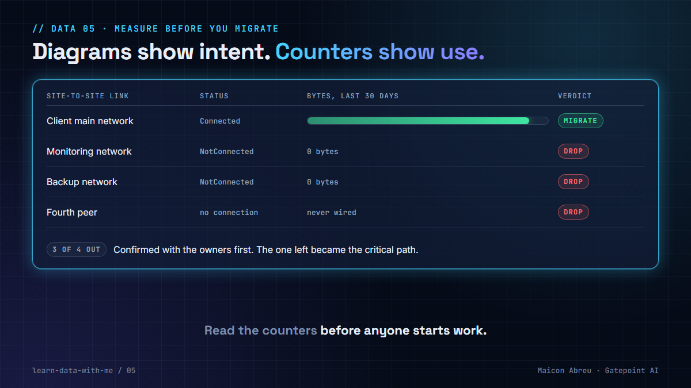

# 05 · Measure before you migrate

> **The idea:** a migration's scope usually comes from diagrams and inventories, which describe what someone once intended. Counters describe what is actually used: bytes on a network link, scans and writes on a table, runs that moved rows. Read them first, and a lot of scope disappears before anyone starts working on it.



## The problem

Every object you migrate costs engineering work: a link to rebuild and test, a table to dump, restore and verify, a job to port and re-schedule, a cutover test and a rollback path for each. Migrations tend to move everything that's listed, because nobody wants to be the person who dropped something that turned out to matter.

The list is usually wrong in the expensive direction. Links built for a project that ended, tables nothing has read in a year, jobs that run every night and move zero rows, a gateway object created and never connected. On a diagram they look the same as the integration production can't live without.

## What I did

On the ~7.8 TB migration from Azure to Oracle Cloud for a European national postal operator, the source network gateway had **four site-to-site links defined**, and each one would have needed rebuilding on the new cloud.

Before touching any of them, I read the gateway's own connection status and byte counters:

- **One** was `Connected` and carrying real traffic in both directions: the client's main network.
- **Two** were `NotConnected`, with zero bytes in and out.
- **One** existed as a gateway object with no connection attached at all.

So three of the four were scoped out, and with them three tunnels to rebuild, three firewall change requests and three teams to coordinate. The one that was left became the critical path: no testing and no cutover until it worked.

## The decision

1. **Measure a representative period.** At least a full business cycle: a month catches the month-end jobs a week would miss.
2. **Sort every item into live, dormant or never wired** by its counters, not its status. "Enabled" with zero bytes is dormant.
3. **Confirm the drops with the owner, in writing.** Measurement proposes the scope. The owner decides it.
4. **Spend what you saved on the live items.** Fewer integrations means more testing time for the ones that matter.

## The same check for tables, in SQL

PostgreSQL keeps the equivalent counters per table. Read them on the source before you plan what to move:

```sql
SELECT s.relname,
       s.seq_scan + COALESCE(s.idx_scan, 0)    AS reads,
       s.n_tup_ins + s.n_tup_upd + s.n_tup_del AS writes,
       s.last_seq_scan, s.last_idx_scan,      -- PostgreSQL 16+
       d.stats_reset
FROM pg_stat_user_tables s
CROSS JOIN pg_stat_database d
WHERE d.datname = current_database()
ORDER BY reads, writes, s.relname;
```

Three things to know before you trust the zeros:

- **The counters start at `stats_reset`.** A reset last week makes everything look quiet.
- **They are per instance.** Reads served by a replica don't appear on the primary.
- **Your own tooling counts.** A nightly `pg_dump` is a sequential scan of every table. I checked on PostgreSQL 16: one dump added one `seq_scan` to a table nothing else had touched. Look at `idx_scan` and `last_idx_scan`, or subtract the backup's schedule.

## The trade-off

| You gain | You pay |
|---|---|
| Fewer links, tables and jobs to rebuild, test and roll back | A measurement window before the scope is final |
| Test time concentrated on the live path | An owner's sign-off for every drop |
| A dated record of why each item was dropped | Counters you have to understand (reset time, replicas, your own jobs) before you trust them |

## Try it

[`example/measure_before_migrating.py`](example/measure_before_migrating.py): Python, standard library only, a made-up inventory, no installs.

```bash
cd example
python measure_before_migrating.py
```

```
item                       kind           status          GB in  GB out   verdict
Head office network        site-to-site   Connected        41.3     5.2   live
Monitoring network         site-to-site   NotConnected      0.0     0.0   dormant
Backup network             site-to-site   NotConnected      0.0     0.0   dormant
Partner gateway            site-to-site   -                 0.0     0.0   never wired
Nightly export to finance  scheduled job  Enabled           0.0    12.4   live
Legacy fax gateway feed    scheduled job  Enabled           0.0     0.0   dormant

In scope: 2 of 6
```

The same sort works for scheduled jobs, API consumers and tables: anything with a counter.

*Tested with Python 3.12.10 on Windows, 3 Nov 2026.*

## Common mistakes

- **Trusting the status field.** "Enabled" and "Connected" describe configuration. Bytes describe use.
- **Measuring for a week.** Month-end, quarter-end and year-end jobs hide outside short windows.
- **Dropping without the owner's sign-off.** A link with zero traffic can still be the disaster-recovery path. Ask.
- **Not writing down why.** Six months later, someone will ask where the backup link went.

## Go deeper

- [PostgreSQL: The cumulative statistics system](https://www.postgresql.org/docs/current/monitoring-stats.html): `pg_stat_user_tables`, `pg_stat_database` and when counters reset.
- [Google Cloud: Migrate to Google Cloud, Assess and discover](https://cloud.google.com/architecture/migration-to-gcp-assessing-and-discovering-your-workloads): building the inventory and deciding what moves.

---

📣 LinkedIn post: 17 Dec 2026 · Previous: [04 · What restore doesn't restore](../04-what-restore-does-not-restore/) · Next: [06 · Re-runnable by design](../06-re-runnable-by-design/)
