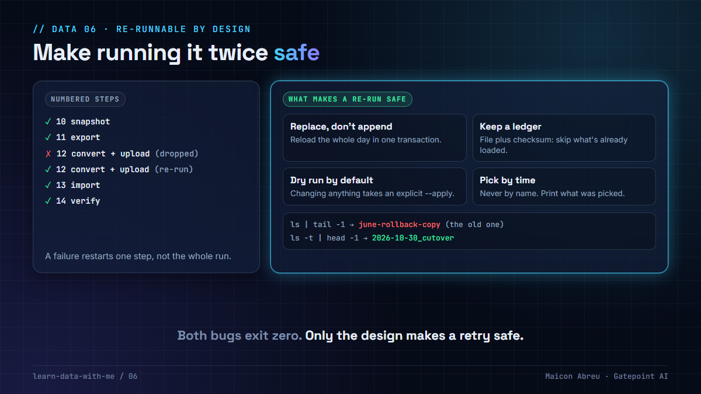

# 06 · Re-runnable by design

> **The idea:** every long data job fails halfway at some point. What matters is what happens when you run it again. Design each step so that running it twice gives the same result as running it once, and so it tells you exactly what it acted on.



## The problem

Migrations and pipelines are sequences of long steps: dump, upload, convert, import, restore, verify. Any of them can stop halfway because of a dropped connection, a lock or a full disk. The natural reaction is to run the step again.

If the step appends, the re-run duplicates data. If it picks its input by a rule that's subtly wrong, the re-run works on the wrong input. Both finish with exit code zero. The dangerous failures in data work are the ones that report success.

## What I did

On the ~7.8 TB migration from Azure to Oracle Cloud for a European national postal operator, where I worked hands-on as the engineer, cloning the application server across clouds was split into **numbered scripts, each safe to run again on its own**: snapshot, export, convert and upload, import, launch, repair, verify. The database dump went up to object storage with a no-overwrite flag, so a retry could never replace what was already there. The access script **did nothing by default** and printed what it would change; it only acted with an explicit `--apply`. Verification was a step of its own, not a log line at the end of another step: `pg_restore --list` had to parse the dump cleanly, and object counts and sizes had to match on both sides of the upload (8,322 of 8,322 objects, zero size mismatches).

That design caught a quiet bug. The monitoring and upload scripts picked "the latest backup" with `ls -d *.backup | tail -1`. That is **alphabetical order, not date order**. With the previous month's backup still on disk as the rollback copy, a date-style name would have sorted before it, and the scripts would have verified and uploaded **last month's dump** while reporting success. The fix was to pick by modification time and to print the name of whatever was picked, so a human sees it.

## The decision

1. **Make loads idempotent.** Replace a whole partition or day inside one transaction (delete and insert, partition swap, or `MERGE`), instead of appending. The same property is what makes Airflow retries and backfills safe.
2. **Keep a ledger** of what was loaded, with a checksum, so a re-run can skip work that's already done.
3. **Dry run by default** for anything that changes access, deletes or overwrites. Acting should take an explicit flag.
4. **Pick inputs by time or by an explicit ID, never by name sorting.** And print what was picked.
5. **Number the steps.** When step 4 fails, you restart at step 4, not at "somewhere in the middle".

## The pattern in SQL and shell

Replace the whole day in one transaction, so a retry produces the same table as the first run:

```sql
BEGIN;
DELETE FROM usage_daily WHERE day = '2026-10-30';
INSERT INTO usage_daily (day, record_id, amount)
SELECT day, record_id, amount FROM staging_usage WHERE day = '2026-10-30';
COMMIT;
```

Or, with a natural key, an upsert (PostgreSQL and SQLite; `MERGE` on most warehouses):

```sql
INSERT INTO usage_daily (day, record_id, amount)
SELECT day, record_id, amount FROM staging_usage WHERE day = '2026-10-30'
ON CONFLICT (day, record_id) DO UPDATE SET amount = EXCLUDED.amount;
```

The ledger the load checks before doing anything:

```sql
CREATE TABLE load_ledger (
    file_name  text        NOT NULL,
    sha256     text        NOT NULL,
    row_count  integer     NOT NULL,
    loaded_at  timestamptz NOT NULL DEFAULT now(),
    PRIMARY KEY (file_name, sha256)
);
```

And picking the input:

```bash
# wrong: sorts by name, so "june-rollback-copy" beats "2026-10-30_cutover"
ls -d /mnt/pgbackup/*.backup | tail -1

# right: newest by modification time, and say which one was picked
latest=$(ls -td /mnt/pgbackup/*.backup | head -1)
echo "using: $latest"
```

I ran the SQL twice in a row on PostgreSQL 16 and SQLite: same row count and total after the second run as after the first.

## The trade-off

| You gain | You pay |
|---|---|
| Restart any step after any failure, with no cleanup by hand | Design work per step: a key or a partition to replace on |
| No duplicated days after a retry or a backfill | A ledger table, and a checksum computed on every input |
| Failures that show up as failures, not silent successes | A delete-and-insert or merge that costs more than an append |

## Try it

[`example/rerunnable.py`](example/rerunnable.py): Python, standard library only (`sqlite3`), made-up data, no installs.

```bash
cd example
python rerunnable.py
```

```
Part 1: load the same file, then run the step again after a 'failure'
   append:      run 1 + run 2 -> 6 rows, 31.70   <- the day is counted twice
   idempotent:  run 1 loaded; run 2 skipped: already loaded with this checksum -> 3 rows, 15.85

Part 2: pick the latest backup folder
   by name (ls | tail -1):    june-rollback-copy   created 14 Jun 2026   <- the old one
   by time (ls -t | head -1): 2026-10-30_cutover   created 30 Oct 2026
```

*Tested with Python 3.12.10 on Windows, 3 Nov 2026.*

## Common mistakes

- **`INSERT` without a key or a partition replace.** Every retry adds the rows again.
- **"It worked on the retry, so it's fine."** Check what the first, failed run left behind.
- **Picking files with `ls | tail -1`.** It sorts by name. Use time, or pass the exact name.
- **Destructive scripts that act by default.** Make the safe behaviour the default and the dangerous one explicit.

## Go deeper

- [dbt: incremental models](https://docs.getdbt.com/docs/build/incremental-models): replace or merge new data instead of appending blindly.
- [Apache Airflow: best practices](https://airflow.apache.org/docs/apache-airflow/stable/best-practices.html): tasks should be idempotent, so retries and backfills are safe.
- [PostgreSQL: INSERT … ON CONFLICT](https://www.postgresql.org/docs/current/sql-insert.html): an upsert in one statement.

---

📣 LinkedIn post: 7 Jan 2027 · Previous: [05 · Measure before you migrate](../05-measure-before-you-migrate/) · Next: [07 · Refresh derived data, don't migrate it](../07-refresh-derived-data/)
