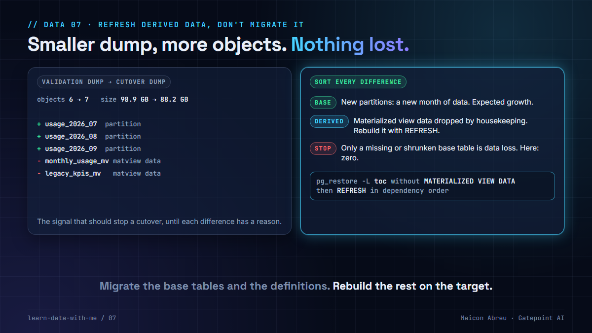

# 07 · Refresh derived data, don't migrate it

> **The idea:** materialized views, aggregate tables and caches are computed from base tables. Migrating their contents costs dump time, transfer and verification, and the copy is stale the moment it lands. Move the definitions, rebuild on the target, and keep derived objects out of the size reconciliation, or their churn will look like data loss.



## The problem

A database dump doesn't know which tables are facts and which are computed from facts. `pg_dump` writes a `MATERIALIZED VIEW DATA` entry for every populated materialized view, and an aggregate table rebuilt by a nightly job is just another table. So derived data gets dumped, uploaded, restored and verified like everything else.

Two things go wrong:

- **It costs cutover time** for data you could recompute, and the copy is already out of date when it arrives.
- **It breaks the reconciliation.** Derived objects change for reasons unrelated to the migration: a housekeeping job drops old aggregates, a refresh rewrites a view. Compare two dumps by size and that churn looks exactly like data loss.

## What I did

On the ~7.8 TB migration from Azure to Oracle Cloud for a European national postal operator, where I worked hands-on as the engineer, the fresh cutover dump came out **smaller** than the validation dump taken months earlier, and with **more files**. On a production migration that's the signal that should stop everything.

I worked through it object by object instead of assuming:

- `pg_restore --list` parsed the new dump cleanly, exit 0.
- No table in the old dump was missing from the new one, and the production table count matched the dump's `TABLE DATA` count exactly.
- The extra objects were **new monthly partitions**.
- The missing gigabytes were **materialized view data**: the client was running a housekeeping sweep of historical aggregates between the two dumps, and was still dropping them.

Materialized view contents are derived. They can be refreshed after the restore instead of migrated, so losing them between two dumps is not data loss. That explanation, with the evidence, is what closed the discrepancy, and the cutover verification ended at 8,322 of 8,322 objects with zero size mismatches.

## The decision

1. **Classify every object as base or derived** in discovery: materialized views, aggregate and summary tables, caches, search indexes rebuilt from tables. Ask the owner which jobs rebuild what.
2. **Migrate definitions, not contents.** Restore with a table of contents that leaves out `MATERIALIZED VIEW DATA`, then refresh on the target.
3. **Refresh in dependency order.** A view that reads another view fails until the inner one is populated.
4. **Reconcile base tables only.** Report derived objects in a separate list, so their churn can't hide a real gap or raise a false one.
5. **Time the refresh.** It runs inside the cutover window, so measure it on the rehearsal, like the restore.

## The check in SQL and shell

Restore everything except materialized view contents:

```bash
pg_restore -l dump_dir > toc.txt
grep -v 'MATERIALIZED VIEW DATA' toc.txt > toc_no_mv_data.txt
pg_restore -d <target_db> -j 8 -L toc_no_mv_data.txt dump_dir
```

Which views still need a refresh, and in what order:

```sql
SELECT schemaname, matviewname, ispopulated FROM pg_matviews ORDER BY 1, 2;

WITH RECURSIVE mv AS (
    SELECT c.oid, c.oid::regclass AS name FROM pg_class c WHERE c.relkind = 'm'
), deps AS (                      -- materialized view -> materialized view it reads
    SELECT DISTINCT v.oid AS mv_oid, r.refobjid AS dep_oid
    FROM mv v
    JOIN pg_rewrite w ON w.ev_class = v.oid
    JOIN pg_depend r  ON r.objid = w.oid AND r.classid = 'pg_rewrite'::regclass
    JOIN mv d         ON d.oid = r.refobjid
    WHERE r.refobjid <> v.oid
), lvl AS (
    SELECT oid, name, 0 AS level FROM mv WHERE oid NOT IN (SELECT mv_oid FROM deps)
    UNION ALL
    SELECT m.oid, m.name, l.level + 1
    FROM deps x JOIN lvl l ON l.oid = x.dep_oid JOIN mv m ON m.oid = x.mv_oid
)
SELECT name, max(level) AS refresh_order FROM lvl GROUP BY name ORDER BY 2, 1;
```

I ran the whole sequence on PostgreSQL 16 for this lesson, with a daily view and a monthly view built on top of it:

```
pg_matviews after the restore:  daily_revenue  ispopulated = false
                                monthly_revenue ispopulated = false
SELECT from monthly_revenue  -> materialized view "monthly_revenue" has not been populated
REFRESH monthly_revenue      -> materialized view "daily_revenue" has not been populated
REFRESH ... CONCURRENTLY     -> CONCURRENTLY cannot be used when the materialized view is not populated
refresh daily, then monthly  -> contents identical to the source
```

`CONCURRENTLY` (no lock on readers) needs a populated view and a unique index, so the first refresh after a restore is always the blocking kind. Plan it before the application is let back in.

## The trade-off

| You gain | You pay |
|---|---|
| Less to dump, upload, restore and verify inside the window | A refresh step in the cutover, which has to be timed on the rehearsal |
| A reconciliation that compares only data that can't be recomputed | A base-or-derived classification to maintain in discovery |
| Derived data that is current on day one, not a stale copy | Dependency ordering, and a blocking first refresh |

## Try it

[`example/derived_or_lost.py`](example/derived_or_lost.py): Python, standard library only (`sqlite3`), made-up inventories, no installs.

```bash
cd example
python derived_or_lost.py
```

```
Validation dump: 6 objects,   98.9 GB
Cutover dump:    7 objects,   88.2 GB   <- +1 objects, -10.7 GB

   gone   reporting.legacy_kpis_mv     matview_data  derived: dropped by housekeeping
   gone   reporting.monthly_usage_mv   matview_data  derived: dropped by housekeeping
   new    billing.usage_2026_07        partition     expected: a new month
   new    billing.usage_2026_08        partition     expected: a new month
   new    billing.usage_2026_09        partition     expected: a new month

   Base tables missing: 0   base tables that shrank: 0
   Verdict: no base data lost. The smaller dump is derived data that was dropped.

Aggregate copied: 90 rows. Aggregate rebuilt from the base table: 90 rows.
   identical: True
```

*Tested with Python 3.12.10 on Windows, 3 Nov 2026.*

## Common mistakes

- **Comparing dumps by total size.** Derived objects move the total for reasons that have nothing to do with the migration. Compare base tables by count and size, derived objects by definition.
- **Calling a missing aggregate data loss.** Check whether it's derived and whether the owner dropped it, before escalating.
- **Refreshing in alphabetical order.** Build the dependency order from the catalog.
- **Forgetting aggregate tables that aren't materialized views.** A summary table rebuilt by a nightly job is derived too. The job, not the dump, is what has to move.

## Go deeper

- [PostgreSQL: REFRESH MATERIALIZED VIEW](https://www.postgresql.org/docs/current/sql-refreshmaterializedview.html): `CONCURRENTLY` and its unique-index requirement.
- [PostgreSQL: pg_restore](https://www.postgresql.org/docs/current/app-pgrestore.html): `-l` and `-L`, restoring from an edited table of contents.
- [dbt: materializations](https://docs.getdbt.com/docs/build/materializations): in a dbt project the derived layer is code, and rebuilding it is `dbt build`.
- Related, in my AI lessons: [Verified means reconciled](https://github.com/gatepoint-ai/learn-ai-with-me/tree/main/11-verified-means-reconciled), the full verification of that cutover.

---

📣 LinkedIn post: 14 Jan 2027 · Previous: [06 · Re-runnable by design](../06-re-runnable-by-design/) · Next: [08 · Late-arriving data](../08-late-arriving-data/)
