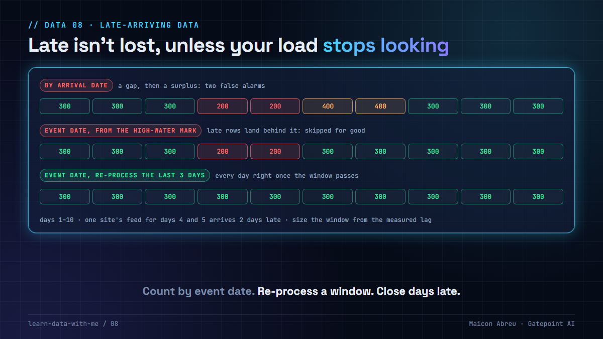

# 08 · Late-arriving data

> **The idea:** a record belongs to the day the event happened, not the day it reached you. Count by event date, re-process a window behind your high-water mark on every run, size that window from the measured lag, and treat a day as provisional until the window has passed.



## The problem

Data arrives late all the time: a file held back by a transfer problem, a device that was offline, a partner that sends corrections on Monday for last week. Nothing is lost. The records just turn up after the day they describe.

How you build the daily table decides what that lateness looks like:

- **Count by arrival date,** and a late feed shows as a gap on the day it should have arrived and a surplus on the day it did. Two false alarms, in opposite directions.
- **Count by event date with a plain incremental load,** one that only takes rows newer than the latest date already loaded, and the late rows fall behind the high-water mark. The job never looks back, so they're skipped for good. No error, a permanent gap.
- **Re-process a window behind the high-water mark,** and the late rows land on the right day as they arrive. The cost is that the last few days stay provisional.

## What I saw

In revenue assurance, late records are routine, and they're the classic false alarm. A usage reconciliation that runs by arrival date flags a site as unbilled on Tuesday and over-billed on Thursday, and both alerts are about the same records. Analysts learn to distrust the alerts, which is worse than having none.

That's why the [leakage pipeline](../leakage-pipeline/) plants a late-arriving feed as a **control**: one site's usage arrives two days late, and the acceptance check fails if the pipeline flags it. A reconciliation that can't tell late from lost isn't ready.

## The decision

1. **Store both timestamps.** The event time and the time you received it. Without the second one, you can't measure lateness or reproduce what a past run saw.
2. **Partition and aggregate by event date.**
3. **Re-process a window behind the high-water mark** on every run, replacing those days (lesson [06](../06-re-runnable-by-design/)), not appending.
4. **Size the window from the measured lag,** not a guess. Take a high percentile of `received - event` and add margin.
5. **Publish a close date.** Days inside the window are provisional. Downstream reports and reconciliations should say so, or wait.
6. **Handle what arrives after close explicitly:** restate the closed day and log the restatement, or book it to an adjustment. Pick one and document it.

## The check in SQL

How late is late? Measure it (PostgreSQL and DuckDB):

```sql
SELECT percentile_cont(0.50) WITHIN GROUP (ORDER BY lag_hours) AS p50_hours,
       percentile_cont(0.99) WITHIN GROUP (ORDER BY lag_hours) AS p99_hours,
       max(lag_hours)                                           AS max_hours
FROM (
    SELECT extract(epoch FROM received_ts - event_ts) / 3600.0 AS lag_hours
    FROM raw_usage
    WHERE received_ts >= TIMESTAMP '2026-10-01'
) t;
```

Then make the window part of the model. In dbt, an incremental model that re-processes the last three days on every run:

```sql
{{ config(
    materialized = 'incremental',
    incremental_strategy = 'delete+insert',
    unique_key = 'record_id'
) }}

SELECT record_id, site, CAST(event_ts AS DATE) AS usage_date, amount, received_ts
FROM {{ source('raw', 'usage') }}

WHERE CAST(event_ts AS DATE) >= (SELECT max(usage_date) FROM {{ this }}) - INTERVAL '3 days'

```

The `WHERE` on `{{ this }}` is the window. Without the `- INTERVAL '3 days'` it's the plain high-water mark from version 2 of the example, the one that skips late rows.

## The trade-off

| You gain | You pay |
|---|---|
| Every record on its event day, however late it arrived | Re-reading and rewriting the window on every run |
| No paired false alarms (gap, then surplus) | Recent days that are provisional until the window passes |
| Lateness as a measured number, so the window is justified | A second timestamp to carry through every layer |

## Try it

[`example/late_arrivals.py`](example/late_arrivals.py): Python, standard library only (`sqlite3`), made-up data, no installs.

```bash
cd example
python late_arrivals.py
```

```
Every day should total 300. '-' is short, '+' is over.

1) Counted by arrival date
   1:300  2:300  3:300  4:200-  5:200-  6:400+  7:400+  8:300  9:300  10:300
   days wrong: 4

2) By event date, incremental from the high-water mark
   1:300  2:300  3:300  4:200-  5:200-  6:300  7:300  8:300  9:300  10:300
   days wrong: 2

3) By event date, re-processing the last 3 days on every run
   1:300  2:300  3:300  4:300  5:300  6:300  7:300  8:300  9:300  10:300
   days wrong: 0
```

*Tested with Python 3.12.10 on Windows, 3 Nov 2026. The lag query was run on DuckDB.*

## Common mistakes

- **Filtering the incremental load on arrival time and grouping on event time.** It looks right until the first late file.
- **A window shorter than the lag.** Measure the 99th percentile. The maximum tells you whether you also need a restatement process.
- **Reconciling the provisional days as if they were final.** Run the reconciliation on closed days, or label the open ones.
- **Throwing away the received timestamp in staging.** You need it to measure lag, debug a run, and replay what the pipeline knew at the time.

## Go deeper

- [dbt: incremental models](https://docs.getdbt.com/docs/build/incremental-models): `is_incremental()`, `{{ this }}` and strategies.
- [dbt: incremental strategies](https://docs.getdbt.com/docs/build/incremental-strategy): `append`, `merge`, `delete+insert` and which adapters support them.
- [Apache Airflow: data intervals](https://airflow.apache.org/docs/apache-airflow/stable/core-concepts/dag-run.html#data-interval): why a run covers a period, not "now".
- [DataTalksClub Data Engineering Zoomcamp](https://github.com/DataTalksClub/data-engineering-zoomcamp): batch and streaming, free.

---

📣 LinkedIn post: 21 Jan 2027 · Previous: [07 · Refresh derived data, don't migrate it](../07-refresh-derived-data/) · Next: [09 · Tests as controls](../09-tests-as-controls/)
