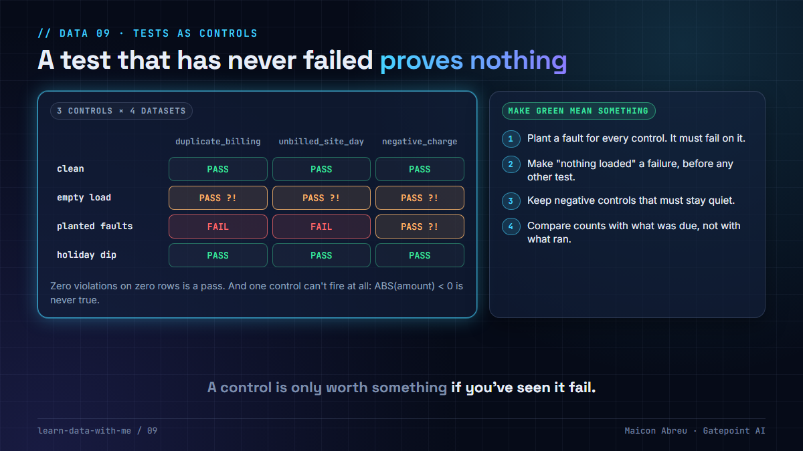

# 09 · Tests as controls

> **The idea:** a data test is a control, and a control is only worth something if it can fail. Prove each one fires on a fault you planted, make "nothing was loaded" a failure instead of a pass, and keep a negative control that must stay quiet. A suite that has never been red proves nothing.



## The problem

A dbt test is a query that returns violations: zero rows means pass. That's the same shape as a revenue-assurance control, and it has the same two blind spots:

- **Zero rows on zero data.** If the load wrote nothing, a uniqueness test, a reconciliation and a range check all return nothing, and all pass. The run is green on a day with no data.
- **A control that can't fire.** A condition that is always false, a join on the wrong key, a filter that excludes the rows it should catch. It passes every day, in production, for months, and nobody notices, because passing is what it's supposed to do.

Both look exactly like a healthy pipeline.

## What I saw and did

Revenue assurance runs on controls, and the discipline that keeps them honest is old: you don't trust a control until you've seen it catch a gap you put there on purpose.

I built the same discipline into [Argus](https://github.com/gatepoint-ai/learn-ai-with-me/tree/main/argus), my open-source revenue-assurance app. Its test data plants four faults on purpose, and a negative control: every site drops 70% on the same day, the way a public holiday looks. That day raised 8 breaches, all 8 were suppressed as systemic, and the gate fails if any of them opens.

On a rating proof of concept I worked on, the evaluation gate carried the other guard. A pass rate computed as `passed / total` is undefined when nothing ran, and the naive implementation returns 1.0, which opens the gate on an evaluation that never happened. The gate treated zero cases as a failure, and compared the number of cases evaluated with the number in the fixture, so a run that died halfway couldn't report 100%.

The [leakage pipeline](../leakage-pipeline/) uses both: `check/acceptance.py` fails unless every planted fault is found and every control stays quiet.

## The decision

1. **Write each control as a query that returns violations,** with the evidence in the rows: which record, which site, which day.
2. **Plant a fault for every control** and keep it in a test fixture or seed. A control that doesn't fire on its fault is broken.
3. **Keep negative controls:** cases that look alarming and must not be flagged (a holiday dip, a late feed, zero-rated traffic).
4. **Make "nothing loaded" a failure.** A load precondition (rows exist for the day, every expected feed landed) runs before the other tests mean anything.
5. **Compare counts with what was expected,** not only results with each other. "40 of 40 passed" means nothing if 60 were due.
6. **Keep the failures.** Store the violating rows, so the alert links to evidence instead of a count.

## The check in SQL and dbt

A singular test that fails when the day has no rows. Save it as `tests/assert_usage_loaded.sql`; it returns a row, so it fails, when nothing was loaded:

```sql
SELECT 'no usage rows for ' || CAST(CURRENT_DATE - 1 AS VARCHAR) AS failure
WHERE NOT EXISTS (
    SELECT 1 FROM {{ ref('fct_usage') }} WHERE usage_date = CURRENT_DATE - 1
)
```

No semicolon at the end: dbt wraps every test in a subquery, and a trailing `;` breaks it.

Keep the evidence and set when a control blocks the build:

```yaml
models:
  - name: mart_unbilled_usage
    data_tests:
      - dbt_utils.expression_is_true:
          arguments:
            expression: "not is_flagged"
          config:
            severity: error
            store_failures: true      # violating rows land in a table you can query
```

The `expression_is_true` test above is the control. The planted faults in the seed data are what prove it: the build must fail on the fault days and pass everywhere else, including the negative-control days.

I ran the not-exists query on PostgreSQL 16 against an empty table (one failure row) and against a loaded one (no rows), and both dbt snippets in a `dbt build` on DuckDB (dbt-core 1.12, dbt-utils 1.4).

## The trade-off

| You gain | You pay |
|---|---|
| Controls you have seen fail, so a green run means something | Fixtures with planted faults, maintained as the model changes |
| An empty load that turns the build red, not green | A precondition per source and a list of expected feeds |
| Evidence rows for every alert | Storage for failures, and someone who reads them |

## Try it

[`example/controls_that_can_fail.py`](example/controls_that_can_fail.py): Python, standard library only (`sqlite3`), made-up data, no installs.

```bash
cd example
python controls_that_can_fail.py
```

```
Controls as written  (PASS = zero violations)
   dataset      duplicate_billing   unbilled_site_day     negative_charge
   clean                     PASS                PASS                PASS
   empty                     PASS                PASS                PASS
   planted               FAIL (1)            FAIL (1)                PASS
   holiday                   PASS                PASS                PASS

Controls with a 'something was loaded' precondition  (PASS = zero violations)
   dataset      duplicate_billing   unbilled_site_day     negative_charge
   clean                     PASS                PASS                PASS
   empty                 FAIL (1)            FAIL (1)            FAIL (1)
   planted               FAIL (1)            FAIL (1)                PASS
   holiday                   PASS                PASS                PASS

Planted-fault check: every control must FAIL on the 'planted' row.
   controls that never fired on their own fault: negative_charge
```

The `negative_charge` control has a bug on purpose: `ABS(amount) < 0` can never be true. It has been green on every dataset, and only the planted fault shows it can't work.

*Tested with Python 3.12.10 on Windows, 3 Nov 2026.*

## Common mistakes

- **Trusting a test because it has never failed.** It may not be able to.
- **Tests that only run on the data that arrived.** Add the precondition, or freshness on the source.
- **Alert thresholds tuned until the alerts stop.** Check the planted faults still fire after every tuning change.
- **No negative controls.** Without them you can't tell a good control from one that flags everything.

## Go deeper

- [dbt: data tests](https://docs.getdbt.com/docs/build/data-tests): generic and singular tests, `store_failures`, `severity`.
- [dbt: unit tests](https://docs.getdbt.com/docs/build/unit-tests): fixed inputs and expected outputs for one model, the natural home for planted faults.
- [dbt-utils on dbt Hub](https://hub.getdbt.com/dbt-labs/dbt_utils/latest/): `expression_is_true`, `recency`, `unique_combination_of_columns`.
- [Google SRE book, Testing for reliability](https://sre.google/sre-book/testing-reliability/): why the tests themselves need testing.

---

📣 LinkedIn post: 28 Jan 2027 · Previous: [08 · Late-arriving data](../08-late-arriving-data/) · Next: [10 · The leakage pipeline](../leakage-pipeline/)
