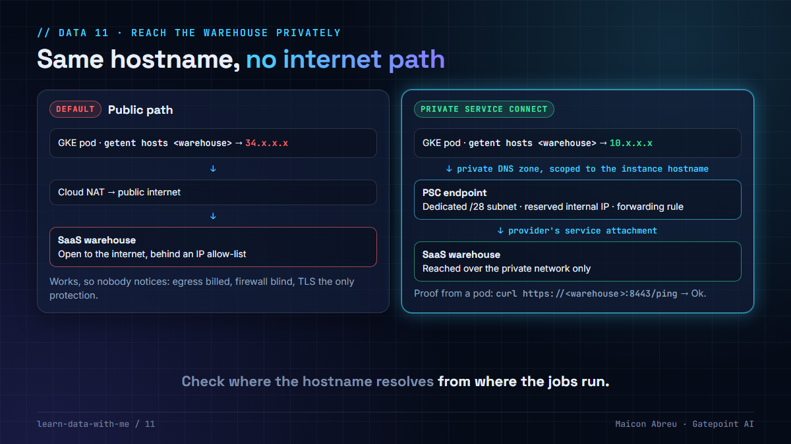

# 11 · Reach the warehouse privately

> **The idea:** a SaaS warehouse lives outside your network, and by default your pipelines reach it over the public internet. A private endpoint and a private DNS zone make its hostname resolve to an internal IP, so every query and every load stays on the provider's private network. Then prove it from where the jobs run.



## The problem

A managed warehouse (ClickHouse Cloud, Snowflake, Databricks, BigQuery Omni and others) runs in the provider's account, not yours. Point a job at its hostname and the lookup returns a public IP. The traffic leaves through your NAT gateway and crosses the internet with TLS as its only protection.

That works, which is the trouble. Nothing fails, so nobody notices that:

- every load and query result is **egress**, billed as internet traffic;
- your **firewall rules don't apply** to that path in any useful way;
- the warehouse has to accept connections from the internet, protected by an IP allow-list that someone has to maintain.

## What I did

I created and deployed the Google Cloud environments, in Terraform, for a revenue-assurance platform at a US transportation authority. The analytics warehouse was ClickHouse Cloud, reached from workloads in GKE. Instead of the public path, I set up **Private Service Connect**:

- a **dedicated small subnet** for the endpoint, so its address space never competes with the cluster's;
- a **reserved internal IP** and a **forwarding rule** that targets the warehouse provider's service attachment;
- a **private DNS zone scoped to the exact warehouse hostname**, visible only to our VPC, with an A record pointing at the endpoint IP.

The application kept using the same hostname. Inside the VPC it now resolved to an internal address, and the troubleshooting step in the runbook was one command from inside a pod.

## The decision

1. **Private endpoint for every warehouse a pipeline writes to,** in every environment, not only production.
2. **Scope the private zone to the instance hostname,** not the provider's whole domain, so other instances and the provider's own endpoints still resolve normally.
3. **Bind the zone to the right VPC.** A zone attached to the wrong network fails silently: the hostname just resolves publicly again.
4. **Verify from where the jobs run.** Resolution from your laptop proves nothing about the cluster.
5. **Then close the public door** on the warehouse side, if the provider allows it, so a misconfigured job fails loudly instead of quietly going public.

## The check in code

The Terraform, with names and ranges replaced:

```hcl
resource "google_compute_subnetwork" "warehouse_psc" {
  name                     = "${var.prefix}-warehouse-psc"
  ip_cidr_range            = var.warehouse_psc_cidr          # a /28 is enough
  region                   = var.region
  network                  = google_compute_network.main.id
  private_ip_google_access = true
}

resource "google_compute_address" "warehouse_psc" {
  name         = "${var.prefix}-warehouse-psc-ip"
  region       = var.region
  subnetwork   = google_compute_subnetwork.warehouse_psc.id
  address_type = "INTERNAL"
}

resource "google_compute_forwarding_rule" "warehouse_psc" {
  name                  = "${var.prefix}-warehouse-psc"
  region                = var.region
  network               = google_compute_network.main.id
  subnetwork            = google_compute_subnetwork.warehouse_psc.id
  ip_address            = google_compute_address.warehouse_psc.id
  target                = var.warehouse_service_attachment   # from the provider
  load_balancing_scheme = ""                                 # required for PSC to a published service
}

resource "google_dns_managed_zone" "warehouse_psc" {
  name       = "${var.prefix}-warehouse-psc-zone"
  dns_name   = "${var.warehouse_hostname}."                  # the instance, not the whole domain
  visibility = "private"
  private_visibility_config {
    networks { network_url = google_compute_network.main.self_link }
  }
}

resource "google_dns_record_set" "warehouse_psc" {
  name         = "${var.warehouse_hostname}."
  type         = "A"
  ttl          = 300
  managed_zone = google_dns_managed_zone.warehouse_psc.name
  rrdatas      = [google_compute_address.warehouse_psc.address]
}
```

And the proof, from inside a pod:

```bash
getent hosts <instance>.<region>.p.gcp.clickhouse.cloud     # must print a private IP
curl -s https://<instance>.<region>.p.gcp.clickhouse.cloud:8443/ping   # ClickHouse answers "Ok."
```

## The trade-off

| You gain | You pay |
|---|---|
| No internet path for warehouse traffic, and no public allow-list to maintain | An endpoint per region and per environment, billed by the hour and by data processed |
| Internal routing that your firewall and flow logs can see | A private DNS zone per instance, and the discipline to bind it to the right VPC |
| A hostname that doesn't change for the application | One more thing to recreate when the warehouse instance moves |

## Try it

[`example/private_path_check.py`](example/private_path_check.py): Python, standard library only, no installs. With no arguments it classifies made-up lookups. With a hostname, it resolves it from where you run it.

```bash
cd example
python private_path_check.py
```

```
Where does abc123.region.p.gcp.example-warehouse.cloud resolve?

   from a pod inside the VPC (private zone in place)
      -> 10.0.0.2                     PRIVATE  traffic stays on the internal network
   from a laptop on the internet
      -> 203.0.113.19, 198.51.100.88  PUBLIC   traffic leaves through NAT to the internet
   from a pod, private zone scoped to the wrong VPC
      -> 203.0.113.19                 PUBLIC   traffic leaves through NAT to the internet
```

The addresses are made up: a private one, and two from the documentation ranges reserved for examples.

*Tested with Python 3.12.10 on Windows, 3 Nov 2026.*

## Common mistakes

- **Testing from your laptop.** It resolves publicly by design. Test from a pod, or the VM the job runs on.
- **A private zone for the provider's whole domain.** Every other instance and endpoint under it stops resolving.
- **Forgetting the other environments.** Dev reaching the warehouse publicly is how a public path ends up in the production runbook.
- **Leaving the public endpoint open after the private one works.** Then a job with a stale config still succeeds, publicly.

## Go deeper

- [Google Cloud: Private Service Connect](https://cloud.google.com/vpc/docs/private-service-connect): endpoints for published services.
- [Google Cloud: Private DNS zones](https://cloud.google.com/dns/docs/zones#create-private-zone): visibility and network binding.
- [ClickHouse Cloud: Private Service Connect](https://clickhouse.com/docs/products/cloud/guides/security/connectivity/private-networking/gcp-private-service-connect): the provider side of the same setup.

---

📣 LinkedIn post: 11 Feb 2027 · Previous: [10 · The leakage pipeline](../leakage-pipeline/) · Next: [12 · Database flags on day one](../12-database-flags-on-day-one/)
