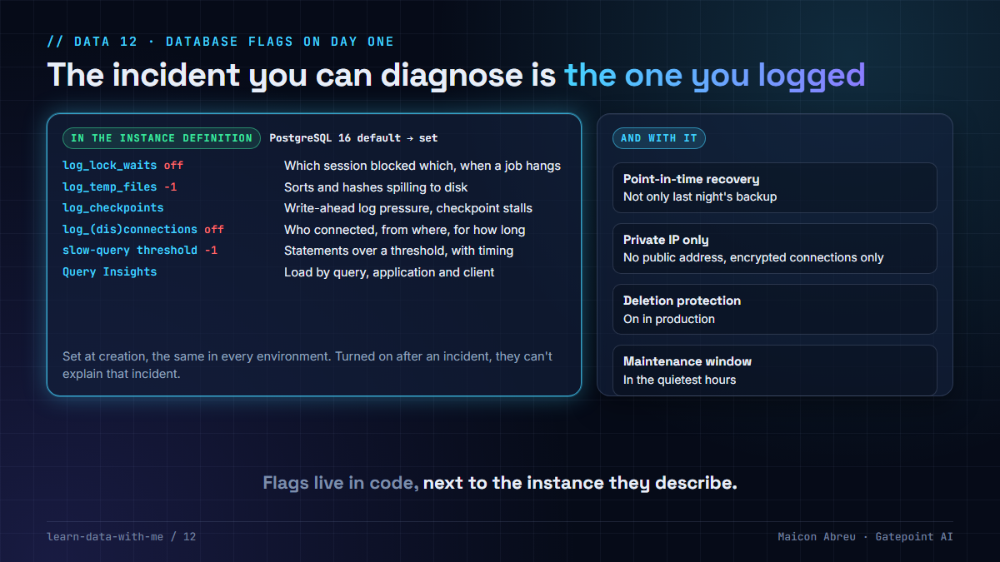

# 12 · Database flags on day one

> **The idea:** the incident you can diagnose is the one you logged. Lock waits, temp-file spills, checkpoints, connections and slow statements are all off or silent by default. Turn them on when the instance is created, in code, together with backups, point-in-time recovery and private networking. After the first incident is too late for that incident.



## The problem

A fresh PostgreSQL instance is quiet. On PostgreSQL 16 I read the defaults straight from `pg_settings`:

```
log_lock_waits               off
log_temp_files               -1     (never log)
log_connections              off
log_disconnections           off
log_min_duration_statement   -1     (never log)
log_checkpoints              on     (the one that's on, since PostgreSQL 15)
deadlock_timeout             1000 ms
```

So the first time a nightly job hangs on a lock, or a query that used to take a second takes ten, or connections run out at 02:00, the logs have nothing to say. You can turn the flags on then, and wait for it to happen again.

Managed services make it easy to skip: the console shows a healthy instance, backups look automatic, and the flags sit on a separate page.

## What I did

I created and deployed the Google Cloud environments, in Terraform, for a revenue-assurance platform at a US transportation authority, including the Cloud SQL PostgreSQL 16 instances. The flags went in with the instance, in the same resource block, so every environment got them on its first `apply`:

- `log_lock_waits`, `log_temp_files`, `log_checkpoints`, `log_connections`, `log_disconnections`;
- Query Insights, with application tags and client addresses recorded;
- automated backups with **point-in-time recovery**, and a fixed retention;
- **private IP only**, no public address, and **encrypted connections only**;
- a maintenance window in the quietest hours, and `deletion_protection` on in production.

`log_lock_waits` is the one I'd defend hardest. On the PostgreSQL migration in [lesson 03](../03-schedule-beats-tuning/), a parallel dump failed twice because batch jobs took `ACCESS EXCLUSIVE` locks. With lock waits logged, that's one line in the log with both process IDs. Without it, it's a week of sampling.

## The decision

1. **Flags live in the instance definition,** not in a ticket or a console click.
2. **The same baseline in every environment.** Dev is where you first need to see a lock wait.
3. **Set a slow-query threshold, don't leave it at `-1`.** Start high and lower it once you know the volume.
4. **`log_temp_files = 0`** logs every spill to disk. If that's too noisy, set a size, but don't leave it off.
5. **Point-in-time recovery and a tested restore,** not only nightly backups.
6. **Private IP and encrypted connections from the start.** Retrofitting network posture means touching every client.

## The check in code

The Terraform block, trimmed:

```hcl
resource "google_sql_database_instance" "main" {
  name                = "${var.prefix}-postgresql"
  database_version    = "POSTGRES_16"
  region              = var.region
  deletion_protection = var.environment == "prod"

  settings {
    tier = var.db_tier

    ip_configuration {
      ipv4_enabled    = false                                # no public IP
      private_network = google_compute_network.main.id
      ssl_mode        = "ENCRYPTED_ONLY"
    }

    backup_configuration {
      enabled                        = true
      point_in_time_recovery_enabled = true
    }

    dynamic "database_flags" {
      for_each = {
        log_lock_waits     = "on"
        log_temp_files     = "0"
        log_checkpoints    = "on"
        log_connections    = "on"
        log_disconnections = "on"
      }
      content {
        name  = database_flags.key
        value = database_flags.value
      }
    }

    insights_config {
      query_insights_enabled  = true
      record_application_tags = true
      record_client_address   = true
    }
  }
}
```

And the check against what the instance actually runs with:

```sql
SELECT name, setting, unit, source
FROM pg_settings
WHERE name IN ('log_lock_waits', 'log_temp_files', 'log_checkpoints',
               'log_min_duration_statement', 'log_connections', 'log_disconnections',
               'deadlock_timeout')
ORDER BY name;
```

`source` tells you whether a value is the default or was set. Run it on every environment after each change.

## The trade-off

| You gain | You pay |
|---|---|
| A lock wait, a spill or a slow query diagnosable from the first time it happens | Log volume and storage, which grow with the thresholds you choose |
| The same evidence in dev, UAT and prod | A baseline to agree and keep in one module |
| Recovery to a point in time, not just to last night | Storage for the write-ahead log that point-in-time recovery keeps |

## Try it

[`example/audit_flags.py`](example/audit_flags.py): Python, standard library only, no installs. With no arguments it audits the PostgreSQL 16 defaults; pass a CSV of `name,setting` from the query above to audit a real instance.

```bash
cd example
python audit_flags.py
```

```
Setting                      Value   Verdict
log_lock_waits                  off   MISSING: you will not see which session blocked which, when a job hangs on a lock
log_temp_files                   -1   MISSING: you will not see queries spilling sorts and hashes to disk (memory too small)
log_checkpoints                  on   ok
log_connections                 off   MISSING: you will not see who connected, from where (audit, connection storms)
log_disconnections              off   MISSING: you will not see session length, and pools that leak connections
log_min_duration_statement       -1   MISSING: you will not see the slow-query log: statements above a threshold, with timing

5 of 6 missing. Set them when the instance is created, in code, not after the first incident.
```

*Tested with Python 3.12.10 on Windows, 3 Nov 2026. The defaults were read from PostgreSQL 16.2.*

## Common mistakes

- **Setting flags in the console.** The next `terraform apply` puts them back, or the next environment never gets them.
- **Logging everything at `log_min_duration_statement = 0` in production.** Every statement, every time. Start with a threshold.
- **Backups without a restore test.** Restore one into a scratch instance on a schedule.
- **A public IP "just for the migration".** It stays.

## Go deeper

- [PostgreSQL: Error reporting and logging](https://www.postgresql.org/docs/current/runtime-config-logging.html): every `log_*` setting.
- [Google Cloud SQL: Configure database flags](https://cloud.google.com/sql/docs/postgres/flags): which flags Cloud SQL supports.
- [Google Cloud SQL: Point-in-time recovery](https://cloud.google.com/sql/docs/postgres/backup-recovery/pitr).
- [Terraform: google_sql_database_instance](https://registry.terraform.io/providers/hashicorp/google/latest/docs/resources/sql_database_instance).

---

📣 LinkedIn post: 18 Feb 2027 · Previous: [11 · Reach the warehouse privately](../11-reach-the-warehouse-privately/) · Next: [13 · Your state file holds the keys](../13-your-state-file-holds-keys/)
