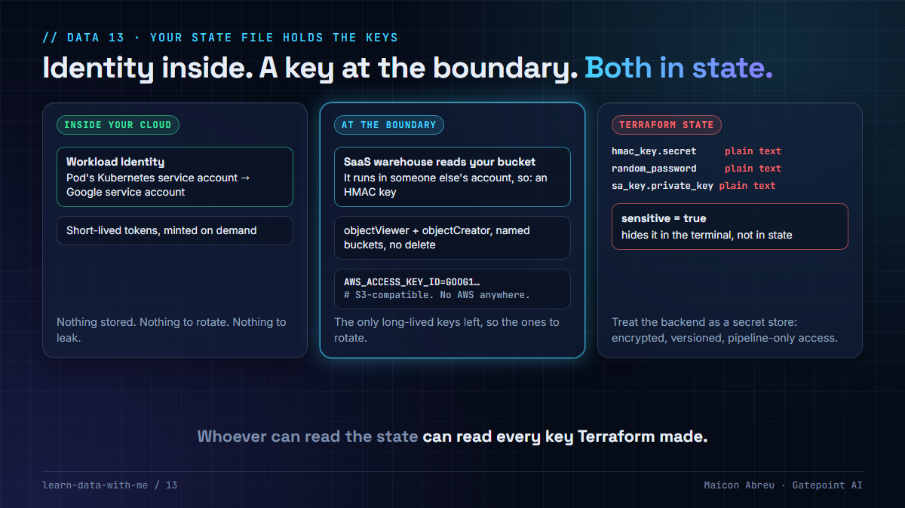

# 13 · Your state file holds the keys

> **The idea:** inside your own platform, give workloads an identity instead of a key. At the boundary with a SaaS warehouse you usually can't, so you end up with a long-lived key, scoped as narrowly as the storage allows. And wherever Terraform generated that key, the secret also sits in plain text in the state file, `sensitive` or not.



## The problem

A modern data platform has two kinds of credentials:

- **Inside your cloud:** pods and jobs can get short-lived credentials from an identity (Workload Identity on GKE, IAM roles for service accounts on EKS, managed identities on Azure). Nothing to store, nothing to rotate, nothing to leak.
- **At the boundary:** a SaaS warehouse that reads your object storage runs in someone else's account. It can't use your workload identity, so it gets a key, for example an S3-compatible HMAC key for a Google Cloud Storage bucket.

When Terraform creates that key, the secret is an attribute of the resource, and Terraform stores every attribute in its state. Marking an output `sensitive = true` hides it in the terminal. The state still has it, readable by anyone who can read the state backend.

## What I did

I created and deployed the Google Cloud environments, in Terraform, for a revenue-assurance platform at a US transportation authority. The two kinds of credentials were handled differently, on purpose:

- **Inside the cluster,** services reached Google APIs through **Workload Identity**: a Kubernetes service account bound to a Google service account, with no key anywhere.
- **The warehouse,** ClickHouse Cloud, needed to read and write files in our buckets. Terraform created a dedicated service account, granted it **read and create on the specific buckets and nothing else** (no delete, no admin), and generated an **HMAC key** for it. The key reached the warehouse configuration as `AWS_ACCESS_KEY_ID` and `AWS_SECRET_ACCESS_KEY`, because that's the S3-compatible format the warehouse understands. That confuses everyone the first time, since there's no AWS anywhere in the system.
- **Install-time secrets** were generated from one credentials file into Kubernetes secrets, with templates committed and real values gitignored. The VPN shared secret was passed as a `TF_VAR_` environment variable, never written to a file.

## The decision

1. **Identity before keys,** everywhere the workload runs in your cloud.
2. **One service account per external consumer,** so a leaked key reveals one consumer and can be revoked alone.
3. **Least privilege on the bucket,** not the project: read and create, no delete, on named buckets.
4. **Treat the state backend as a secret store,** because it is one: encrypted, versioned, readable only by the pipeline that applies it and a break-glass role.
5. **Rotate the boundary keys on a schedule.** They're now the only long-lived credentials you have, which makes them the ones that matter.
6. **Know which resources put secrets in state:** HMAC keys, service account keys, generated passwords, database users. Audit the state, not only the code.

## The check in code

The boundary credential, with names replaced:

```hcl
resource "google_service_account" "warehouse" {
  account_id   = "${var.prefix}-warehouse-sa"
  display_name = "SaaS warehouse access to landing buckets"
}

resource "google_storage_bucket_iam_member" "warehouse_read" {
  bucket = google_storage_bucket.landing.name
  role   = "roles/storage.objectViewer"
  member = "serviceAccount:${google_service_account.warehouse.email}"
}

resource "google_storage_bucket_iam_member" "warehouse_write" {
  bucket = google_storage_bucket.landing.name
  role   = "roles/storage.objectCreator"          # create, but not delete or overwrite-by-delete
  member = "serviceAccount:${google_service_account.warehouse.email}"
}

resource "google_storage_hmac_key" "warehouse" {
  service_account_email = google_service_account.warehouse.email
}
```

And where the secret ends up:

```bash
terraform state show google_storage_hmac_key.warehouse   # prints the secret
terraform state pull > state.json                         # so does the raw state
```

## The trade-off

| You gain | You pay |
|---|---|
| No stored secret for anything running inside your cloud | Identity bindings per namespace and service account to maintain |
| A boundary key that can only read and create, on named buckets | A rotation process for every key that has to exist |
| A state backend you can reason about | Access controls and audit on the backend, which most teams leave open |

## Try it

[`example/scan_state.py`](example/scan_state.py): Python, standard library only, no installs. With no arguments it scans a made-up state with fake values. Point it at `terraform state pull` output to scan a real one you're allowed to read.

```bash
cd example
python scan_state.py
```

```
resource                               attribute    marked sensitive  stored in state
google_storage_hmac_key.warehouse      secret       yes               yes, 32 chars, plain text
random_password.db                     result       yes               yes, 23 chars, plain text
google_service_account_key.puller      private_key  NO                yes, 24 chars, plain text

3 secrets in this state. Marked or not, anyone who can read the state can read them.
```

*Tested with Python 3.12.10 on Windows, 3 Nov 2026.*

## Common mistakes

- **Thinking `sensitive = true` protects the value.** It hides it from plan and output. The state still has it.
- **A state bucket readable by every engineer.** That's the same as giving everyone every generated secret.
- **One shared key for every external consumer.** You can't revoke one without breaking all.
- **Service account key files on laptops and shared drives.** If a workload can use an identity, delete the key.

## Go deeper

- [Terraform: Sensitive data in state](https://developer.hashicorp.com/terraform/language/manage-sensitive-data): what is and isn't protected.
- [Google Cloud: Workload Identity Federation for GKE](https://cloud.google.com/kubernetes-engine/docs/concepts/workload-identity).
- [Google Cloud Storage: HMAC keys](https://cloud.google.com/storage/docs/authentication/hmackeys): the S3-compatible credential.
- Related, in my AI lessons: [No API keys](https://github.com/gatepoint-ai/learn-ai-with-me/tree/main/01-no-api-keys), the same principle for AI services.

---

📣 LinkedIn post: 25 Feb 2027 · Previous: [12 · Database flags on day one](../12-database-flags-on-day-one/) · Next: [14 · Kafka across three zones](../14-kafka-across-three-zones/)
