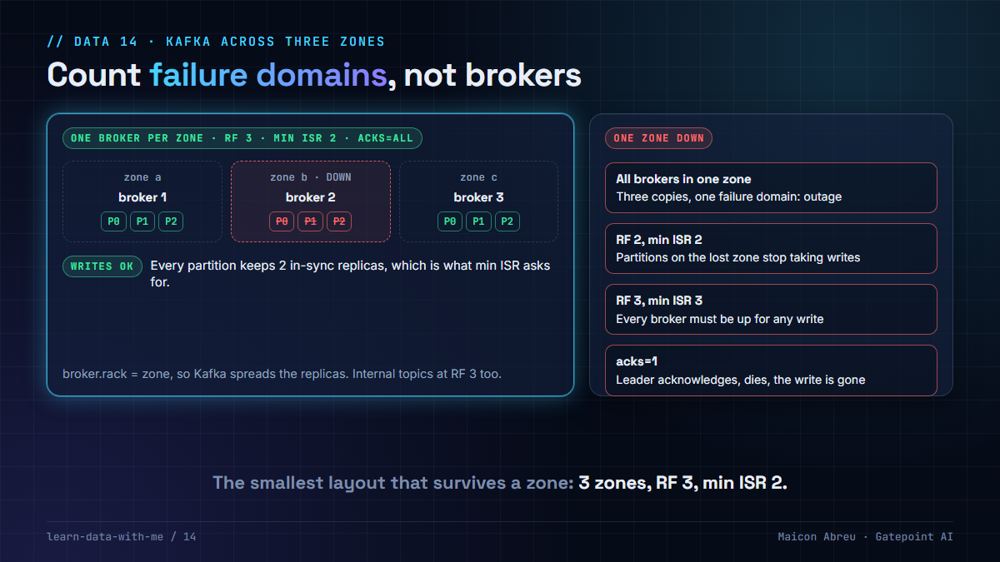

# 14 · Kafka across three zones

> **The idea:** three brokers aren't high availability unless they're in three zones, and three zones aren't enough unless every partition has a replica in each and producers wait for two of them. A broker per zone, replication factor 3, `min.insync.replicas` 2 and `acks=all` is the smallest layout that keeps taking writes when a zone goes down.



## The problem

Kafka replicates partitions across brokers, but it doesn't know where the brokers are unless you tell it, and it doesn't refuse a write that only one replica has seen unless you configure it to. The common half-measures:

- **Three brokers in one zone.** Three copies, one failure domain. A zone outage is a full outage.
- **Replication factor 2.** Lose one zone and a third of the partitions are down to one replica. With `min.insync.replicas = 2` they stop taking writes; with 1, they keep writing to a single copy and you've given up durability without noticing.
- **`min.insync.replicas` equal to the replication factor.** Every broker has to be up for any write to succeed. One zone down blocks everything.

## What I did

I created and deployed the Google Cloud environments, in Terraform, for a revenue-assurance platform at a US transportation authority. Event streaming and change data capture ran on **self-managed Kafka on VMs: three brokers, one in each of three zones** of the region.

The network work around it was most of the job:

- the brokers lived in their own VPC, **peered with the platform's VPC in both directions**. The two peerings have to be created one after the other, so the second depends on the first in Terraform;
- firewall rules targeted the brokers by **network tag**, allowing the broker port only from the GKE pod range and the analytics subnet, plus inter-broker traffic between tagged brokers;
- on-premises producers reached the brokers through a single proxy host, which made it the one address the ingress rule had to allow, and also a single point of failure worth calling out.

Running Kafka on VMs instead of a managed service was a real trade: more operational work, but full control of version and configuration, and no per-message pricing.

## The decision

1. **One broker per zone, at least three zones.** Tell Kafka where they are with `broker.rack` set to the zone, so replicas are spread across racks.
2. **Replication factor 3** for every topic that matters, including internal ones (`offsets.topic.replication.factor`, `transaction.state.log.replication.factor`).
3. **`min.insync.replicas = 2` and producers on `acks=all`.** One zone can go without blocking writes or losing acknowledged data.
4. **`unclean.leader.election.enable = false`.** A replica that wasn't in sync shouldn't become leader and silently drop data.
5. **VPC peering isn't transitive.** A network peered with the platform can't reach the brokers through it. Peer what needs to reach them, or route through something that can.
6. **No single path for producers.** One proxy in front of every on-premises producer is one failure away from a gap in the data.

## The check in code

Broker and topic settings (Kafka `server.properties` and topic configs):

```properties
broker.rack=<zone of this broker>         # different on each broker
default.replication.factor=3
min.insync.replicas=2
offsets.topic.replication.factor=3
transaction.state.log.replication.factor=3
unclean.leader.election.enable=false
```

```properties
# producer
acks=all
enable.idempotence=true
```

And the network, with names replaced:

```hcl
resource "google_compute_network_peering" "platform_to_kafka" {
  name         = "platform-to-kafka"
  network      = google_compute_network.main.self_link
  peer_network = data.google_compute_network.kafka.self_link
}

resource "google_compute_network_peering" "kafka_to_platform" {
  name         = "kafka-to-platform"
  network      = data.google_compute_network.kafka.self_link
  peer_network = google_compute_network.main.self_link
  depends_on   = [google_compute_network_peering.platform_to_kafka]   # peerings are created one at a time
}

resource "google_compute_firewall" "consumers_to_kafka" {
  name          = "allow-consumers-to-kafka"
  network       = data.google_compute_network.kafka.self_link
  direction     = "INGRESS"
  allow {
    protocol = "tcp"
    ports    = [tostring(var.kafka_port)]
  }
  source_ranges = [var.gke_pods_cidr, var.analytics_subnet_cidr]
  target_tags   = ["kafka-broker"]
}
```

## The trade-off

| You gain | You pay |
|---|---|
| Writes and reads that survive the loss of any one zone | Three brokers' worth of VMs and disks, and cross-zone replication traffic |
| No acknowledged write lost to a single failure | Producer latency: `acks=all` waits for two replicas |
| Full control of version and configuration on VMs | Upgrades, patching, disk and monitoring are yours, not a provider's |

## Try it

[`example/zone_failure.py`](example/zone_failure.py): Python, standard library only, no installs. It places six partitions on three brokers and takes each zone down in turn.

```bash
cd example
python zone_failure.py
```

```
3 brokers, one per zone, RF 3, min ISR 2
   zone a down: 6/6 partitions take writes, 6/6 serve reads   ok
   ...
3 brokers, all in zone a, RF 3, min ISR 2
   zone a down: 0/6 partitions take writes, 0/6 serve reads   OUTAGE
   ...
3 brokers, one per zone, RF 2, min ISR 2
   zone a down: 2/6 partitions take writes, 6/6 serve reads   WRITES BLOCKED
   ...
3 brokers, one per zone, RF 3, min ISR 3
   zone a down: 0/6 partitions take writes, 6/6 serve reads   WRITES BLOCKED
   ...
Only one layout survives any single zone: a broker per zone, RF 3, min ISR 2.
```

The model is simplified on purpose: it assumes every live replica is in sync.

*Tested with Python 3.12.10 on Windows, 3 Nov 2026.*

## Common mistakes

- **Counting brokers instead of zones.** Availability comes from failure domains, not machine count.
- **`acks=1` for speed.** The leader acknowledges, then dies before replicating, and the write is gone.
- **Internal topics left at replication factor 1.** Consumer offsets are a topic too.
- **Assuming peering is transitive.** It isn't, on any of the big clouds.

## Go deeper

- [Apache Kafka documentation: Replication](https://kafka.apache.org/documentation/#replication): ISR, `min.insync.replicas`, unclean leader election.
- [Apache Kafka documentation: Rack awareness](https://kafka.apache.org/documentation/#basic_ops_racks).
- [Google Cloud: VPC Network Peering](https://cloud.google.com/vpc/docs/vpc-peering): including why it isn't transitive.

---

📣 LinkedIn post: 4 Mar 2027 · Previous: [13 · Your state file holds the keys](../13-your-state-file-holds-keys/) · Next: [15 · Environments as code](../15-environments-as-code/)
