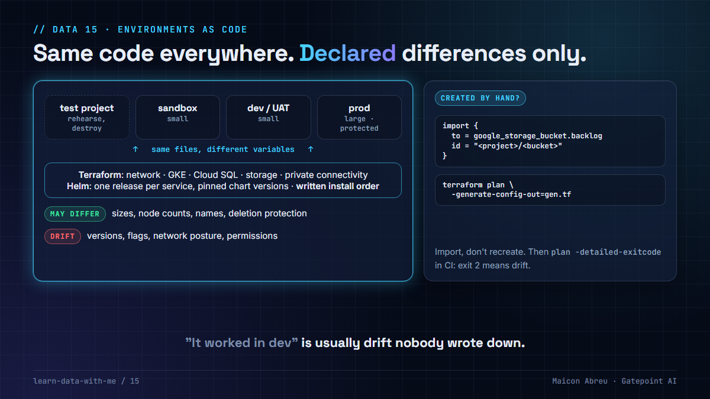

# 15 · Environments as code

> **The idea:** sandbox, dev, UAT and prod should be the same code with a short, declared list of values that may differ: sizes, counts, names. Everything else differing is drift. Rehearse the install in a throwaway project before it touches dev, bring anything created by hand under code with an import, and write the install order down, because "it worked in dev" is usually drift nobody wrote down.



## The problem

Environments drift in small, reasonable steps. A flag gets turned on in prod during an incident. A chart is upgraded in sandbox to test a fix and never in dev. A bucket is created in the console because the transfer had to start today. Each change is fine on its own. Together they mean dev no longer predicts prod, and nobody can say how prod was built.

For data platforms the cost shows up in the pipelines: a job that passes in dev fails in prod on a lock wait dev never logs, a load works in UAT and not in prod because a bucket permission was granted by hand.

## What I did

I created and deployed the Google Cloud environments for a revenue-assurance platform at a US transportation authority: sandbox, dev and prod in Terraform, plus a UAT deployment that mirrored prod.

- **One shape for every environment:** the same files for network, GKE, Cloud SQL, storage and private connectivity, with the differences in each environment's variables.
- **A throwaway project first.** The first full install ran in a test project before dev, specifically to find the problems in the installation process before they reached an environment anyone depended on.
- **Imports for what was created by hand.** Some resources existed before the code did. They came under Terraform through import blocks, kept in their own files, instead of being recreated or left outside.
- **Applications deployed by Helm, one release per service,** each with its own values file and a small script that runs the upgrade from a pinned chart version. Secrets were generated from one credentials file into Kubernetes secrets, with templates committed and real values ignored by git.
- **A written install order.** Some services can't start until others have created what they need (identity before the API gateway, for example). The dependency order was documented, which is what makes a fresh install, or a disaster recovery, something you can actually do.

## The decision

1. **One module, many environments.** Environments differ in variables, never in copied code.
2. **Declare what may differ** (sizes, node counts, names, deletion protection) and treat every other difference as a defect.
3. **Pin versions everywhere:** provider, chart, image, database major version. Promote the same versions from sandbox to prod.
4. **Rehearse in a disposable project,** destroy it afterwards, and do it again before the next big change.
5. **Import, don't recreate,** anything that exists outside the code. Then make the console read-only for those resources.
6. **Write the install order down** and run it the same way every time.

## The check in code

Bring a resource created by hand under Terraform (Terraform 1.5 or later):

```hcl
import {
  to = google_storage_bucket.backlog
  id = "<project>/<bucket-name>"
}
```

```bash
terraform plan -generate-config-out=generated_backlog.tf   # writes the resource block for you
terraform apply                                            # records it in state; changes nothing
```

And the drift check you can run in CI: the same plan against each environment's variables should only ever show the differences you declared.

```bash
for env in sandbox dev prod; do
  terraform -chdir=envs/$env plan -detailed-exitcode -lock=false > /dev/null
  echo "$env: exit $?   # 0 = matches code, 2 = drift, 1 = error"
done
```

## The trade-off

| You gain | You pay |
|---|---|
| Dev and UAT that predict prod | Discipline: no console changes, even during an incident, without a follow-up commit |
| A fresh environment, or a recovery, from code and a written order | A throwaway project per rehearsal, and the time to run it |
| Every hand-made resource visible and reviewable | Import work up front, and generated config to clean up |

## Try it

[`example/env_drift.py`](example/env_drift.py): Python, standard library only, made-up configuration, no installs.

```bash
cd example
python env_drift.py
```

```
1) Settings that differ between environments but aren't allowed to:
   chart_iam        sandbox=0.48.5   dev=0.47.0   prod=0.48.5
   log_lock_waits   sandbox=on   dev=off   prod=on

2) Resources in the cloud that Terraform doesn't manage (created by hand):
   bucket-backlog     -> write an import block, or delete it
   firewall-temp-ssh  -> write an import block, or delete it

Sizes may differ. Versions, flags and network posture may not.
```

*Tested with Python 3.12.10 on Windows, 3 Nov 2026.*

## Common mistakes

- **Copy-pasting the prod folder to make UAT.** Two copies drift from the first commit.
- **Fixing prod in the console during an incident** and never writing it back.
- **`latest` image tags.** Two environments "on the same version" can run different code.
- **An install order that lives in one person's head.** It leaves with them.

## Go deeper

- [Terraform: import blocks](https://developer.hashicorp.com/terraform/language/import): including `-generate-config-out`.
- [Terraform: plan -detailed-exitcode](https://developer.hashicorp.com/terraform/cli/commands/plan): exit code 2 means changes are pending.
- [Helm: chart best practices](https://helm.sh/docs/chart_best_practices/).
- [Google Cloud: Best practices for Terraform](https://cloud.google.com/docs/terraform/best-practices/general-style-structure).

---

📣 LinkedIn post: 11 Mar 2027 · Previous: [14 · Kafka across three zones](../14-kafka-across-three-zones/) · Next: [16 · A landing bucket for a backfill](../16-a-landing-bucket-for-a-backfill/)
