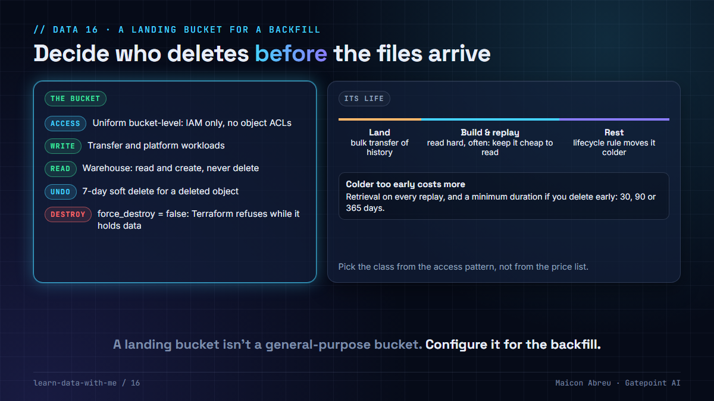

# 16 · A landing bucket for a backfill

> **The idea:** a bucket that receives years of historical files for a backfill is not a general-purpose bucket. Decide up front who can write, who can read and who can delete; how long a deleted file can be recovered; when files move to a colder storage class; and whether Terraform is allowed to destroy it. The defaults answer none of those well.



## The problem

A backfill lands a large amount of history once, then the pipeline reads it hard while loads are built and replayed, then mostly never again. Created with defaults, the bucket:

- lets anyone with project-level storage roles delete what took days to transfer;
- keeps everything in the most expensive storage class forever;
- has no way back from an accidental delete or overwrite;
- can be destroyed by `terraform destroy` along with its contents.

None of that matters until someone runs a cleanup script against the wrong prefix.

## What I did

I created and deployed the Google Cloud environments, in Terraform, for a revenue-assurance platform at a US transportation authority, including a dedicated bucket for transferring the historical backlog. Its settings were chosen for that job:

- **uniform bucket-level access,** so permissions come only from IAM, never from per-object ACLs;
- **`force_destroy = false`,** so Terraform refuses to delete the bucket while it holds objects;
- **a soft-delete window** of a week, so a deleted object can be restored;
- **a lifecycle rule** that moves objects to a colder class after a year, once the loads have been built and replayed;
- **separate identities:** the platform's workloads could manage objects, and the analytics warehouse could only read and create, never delete;
- **versioning off on this bucket,** a deliberate choice for a bulk transfer target, with soft delete as the recovery path instead. The platform's main bucket kept versioning on.

## The decision

1. **One bucket per purpose.** Landing, curated and logs have different readers, writers and retention.
2. **Uniform access and least-privilege IAM,** with deletion granted to as few identities as possible.
3. **A recovery path:** soft delete, versioning, or both. Pick the window from how long it takes you to notice a mistake.
4. **Lifecycle by access pattern,** after the replay period, not on day one. Colder classes have minimum storage durations and retrieval charges.
5. **`force_destroy = false`** on anything holding data you can't regenerate.
6. **Labels** for environment and owner, so the bill and the audit can find it.

## The check in code

```hcl
resource "google_storage_bucket" "backlog" {
  name                        = "${var.prefix}-backlog"
  location                    = var.region
  uniform_bucket_level_access = true
  force_destroy               = false            # destroy fails while objects exist

  soft_delete_policy {
    retention_duration_seconds = 604800          # 7 days to restore a deleted object
  }

  lifecycle_rule {
    condition { age = 365 }                      # after the replay period
    action {
      type          = "SetStorageClass"
      storage_class = "COLDLINE"
    }
  }

  labels = {
    environment = var.environment
    managed_by  = "terraform"
  }
}
```

The read-and-create binding for the warehouse is the same pattern as in [lesson 13](../13-your-state-file-holds-keys/).

## The trade-off

| You gain | You pay |
|---|---|
| A week to undo a delete | Soft-deleted bytes are billed while they're retained |
| Storage cost that drops after the busy period | Retrieval charges and minimum durations if old files are read again |
| A bucket that `terraform destroy` can't take with it | An explicit, manual step to retire it when the time comes |

## Try it

[`example/storage_class_cost.py`](example/storage_class_cost.py): Python, standard library only, no installs. It compares four storage classes for three ways a backfill bucket gets used, in relative price units.

```bash
cd example
python storage_class_cost.py
```

```
10,000 GB of historical files, cost in relative units

A) Kept 3 years, read twice (initial load + one replay)
   ...
   ARCHIVE       71,600   <- cheapest

B) Kept 3 years, read 12 times (replayed every quarter)
   ...
   COLDLINE     192,000   <- cheapest

C) Loaded, then deleted after 20 days
   STANDARD       6,667   <- cheapest
   ...
```

The prices are relative units close to the ratios of Google Cloud Storage list prices when this was written. Check current pricing before deciding with real money.

*Tested with Python 3.12.10 on Windows, 3 Nov 2026.*

## Common mistakes

- **Archive on day one.** The replays in the first months pay retrieval on every read, and an early delete pays the minimum duration anyway.
- **Project-wide storage admin for the pipeline.** A bug in one job can delete another team's data.
- **No recovery path because "it's only a landing bucket".** The source system may not be able to send it again.
- **`force_destroy = true` copied from an example.** It's there to make tutorials easy to clean up.

## Go deeper

- [Google Cloud Storage: Storage classes](https://cloud.google.com/storage/docs/storage-classes): minimum durations and retrieval.
- [Google Cloud Storage: Object Lifecycle Management](https://cloud.google.com/storage/docs/lifecycle).
- [Google Cloud Storage: Soft delete](https://cloud.google.com/storage/docs/soft-delete).
- [Terraform: google_storage_bucket](https://registry.terraform.io/providers/hashicorp/google/latest/docs/resources/storage_bucket).

---

📣 LinkedIn post: 18 Mar 2027 · Previous: [15 · Environments as code](../15-environments-as-code/)
