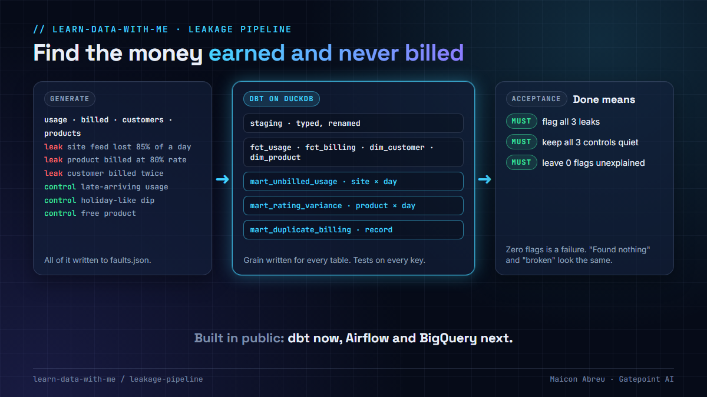

# Learn data with me

**Practical data engineering lessons from 20 years of making numbers reconcile: revenue assurance for telecom operators, star schemas behind finance dashboards, and a 7.8 TB cross-cloud database migration.**

I'm [Maicon Abreu](https://www.linkedin.com/in/mbdabreu/), a senior data engineer with more than 20 years in technology. I've worked on Spark and Kafka pipelines on AWS for telecom clients, dimensional models behind revenue-assurance dashboards, the hands-on engineering of a multi-terabyte PostgreSQL migration, and the Google Cloud environments under a revenue-assurance platform, which I created and deployed in Terraform. Every Thursday I post one lesson on LinkedIn. This repo holds the full version: what happened, the decision behind it, a diagram, and a small example you can run.

The lessons are about **the failures that don't raise errors**: data that never arrived, joins that multiply, dumps that abort on someone else's lock, restores that look like data loss, jobs that report success on the wrong input. Each one comes with the SQL or the command that catches it, tested on PostgreSQL 16, DuckDB or SQLite. They're written for data engineers and analytics engineers.

## Lessons

| # | Lesson | The idea in one line | Example | On LinkedIn |
|---|---|---|---|---|
| 01 | [Missing data raises no error](01-missing-data-raises-no-error/) | A missing number never looks wrong. Reconcile against an independent source, at the level where the loss happens. | Python, no installs | 12 Nov 2026 |
| 02 | [Grain first](02-grain-first/) | Write down what one row is before you join anything. | Python, no installs | 19 Nov 2026 |
| 03 | [Schedule beats tuning](03-schedule-beats-tuning/) | A parallel `pg_dump` aborts when a batch job asks for an `ACCESS EXCLUSIVE` lock. Find the window first. | Python, no installs | 3 Dec 2026 |
| 04 | [What restore doesn't restore](04-what-restore-does-not-restore/) | Every byte came back and the app still couldn't see its tables: role settings live outside the dump. | Python, no installs | 10 Dec 2026 |
| 05 | [Measure before you migrate](05-measure-before-you-migrate/) | Diagrams describe intent. Byte counters describe use, and they shrink the scope. | Python, no installs | 17 Dec 2026 |
| 06 | [Re-runnable by design](06-re-runnable-by-design/) | Every step will fail halfway one day. Make running it twice safe. | Python, no installs | 7 Jan 2027 |
| 07 | [Refresh derived data, don't migrate it](07-refresh-derived-data/) | A smaller dump with more objects can be nothing lost: move definitions, rebuild materialized views. | Python, no installs | 14 Jan 2027 |
| 08 | [Late-arriving data](08-late-arriving-data/) | Count by event date, re-process a window sized from the measured lag, close days late. | Python, no installs | 21 Jan 2027 |
| 09 | [Tests as controls](09-tests-as-controls/) | A test that has never failed proves nothing. Plant the fault; make an empty load fail. | Python, no installs | 28 Jan 2027 |
| 10 | [The leakage pipeline](leakage-pipeline/) | The project behind the lessons, end to end. | dbt + DuckDB | when it passes its acceptance check |

### Data platform

The infrastructure under a data platform, from Google Cloud environments I created and deployed in Terraform.

| # | Lesson | The idea in one line | Example | On LinkedIn |
|---|---|---|---|---|
| 11 | [Reach the warehouse privately](11-reach-the-warehouse-privately/) | A private endpoint and a private DNS zone: same hostname, no internet path. | Python, no installs | 11 Feb 2027 |
| 12 | [Database flags on day one](12-database-flags-on-day-one/) | The incident you can diagnose is the one you logged. | Python, no installs | 18 Feb 2027 |
| 13 | [Your state file holds the keys](13-your-state-file-holds-keys/) | Identity inside, a scoped key at the boundary, and both secrets in Terraform state. | Python, no installs | 25 Feb 2027 |
| 14 | [Kafka across three zones](14-kafka-across-three-zones/) | Count failure domains, not brokers: RF 3, min ISR 2, one broker per zone. | Python, no installs | 4 Mar 2027 |
| 15 | [Environments as code](15-environments-as-code/) | Same code everywhere, declared differences only, imports for what was made by hand. | Python, no installs | 11 Mar 2027 |
| 16 | [A landing bucket for a backfill](16-a-landing-bucket-for-a-backfill/) | Decide who deletes, how to undo and when files go cold, before they arrive. | Python, no installs | 18 Mar 2027 |

*Watch or star the repo to follow along.*

## Leakage pipeline: the project behind the lessons

[`leakage-pipeline/`](leakage-pipeline/) is a revenue-assurance pipeline I'm building in public: synthetic usage and billing data with leaks planted on purpose, a dbt star schema on DuckDB, reconciliation marts, and an acceptance check that fails unless every leak is found and nothing else is flagged. Airflow, BigQuery and Terraform come next. [Start here](leakage-pipeline/README.md).

## How each lesson is organised

Every lesson folder has the same sections: **the idea** · **the problem** (the mechanism, not just the symptom) · **what I saw or did** · **the decision** · **the check in SQL** · **the trade-off** in engineering cost · **diagram** · **try it** · **common mistakes** · **go deeper** (official documentation and free courses).

## Further learning

[RESOURCES.md](RESOURCES.md) lists the free courses and official documentation I recommend. Every link is checked when it's added.

Also by me: [Learn AI with me](https://github.com/gatepoint-ai/learn-ai-with-me), practical lessons from delivering AI systems, and [Argus](https://github.com/gatepoint-ai/learn-ai-with-me/tree/main/argus), the open-source AI revenue-assurance app I built.

## A note on the examples

The examples are **teaching material**, written from scratch for these lessons. They use made-up data, run on a laptop with the Python standard library, and need no accounts or keys. Real systems I describe are referred to by industry only, with no client names or confidential details.

## License

Code is under the [MIT License](LICENSE). Lesson text and diagrams are under [CC BY 4.0](LICENSE-CONTENT.md): share and adapt them freely with credit.

---

Published by **Gatepoint AI** · Questions or ideas for a lesson? Open an issue or message me on [LinkedIn](https://www.linkedin.com/in/mbdabreu/).
