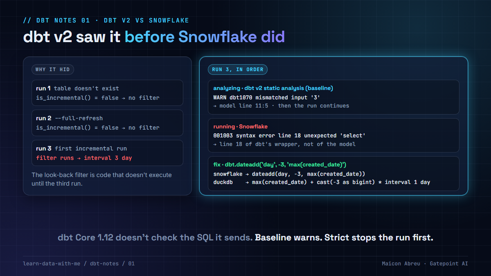

# dbt notes 01 · dbt v2 caught my Snowflake error before Snowflake did

> An incremental model's `is_incremental()` branch doesn't execute until the table already exists and the run isn't a full refresh. On the run where it finally executed, dbt v2's static analysis flagged a DuckDB-only date expression at the exact token, and then Snowflake rejected it. dbt Core 1.12 doesn't check the SQL it sends: it renders the Jinja and passes the result to the warehouse.



## The model

A payments fact built incrementally, with a 3-day look-back so late rows are re-read and replaced on `payment_id`:

```sql
{{ config(materialized='incremental', unique_key='payment_id') }}

select payment_id, order_id, payment_method, status, amount_cents, created_date
from {{ ref('stg_stripe__payments') }}

where created_date >= (select max(created_date) - interval 3 day from {{ this }})

```

The look-back filter came from a local DuckDB copy of the project, where it worked. DuckDB accepts `interval 3 day` with a bare number. Snowflake doesn't.

## Why it hid

dbt's docs list three conditions. [`is_incremental()`](https://docs.getdbt.com/docs/build/incremental-models) is true only if all three hold:

- the model already exists as a table in the database;
- `--full-refresh` is not passed;
- the model is configured with `materialized='incremental'`.

That makes the filter code that only runs from the second real build onwards. Here is what actually ran on Snowflake:

| Run | What I ran | `is_incremental()` | Filter executed? | Result |
|---|---|---|---|---|
| 1 | `dbt run` | false: the table didn't exist | no | `create table as select`, all rows |
| 2 | `dbt run --full-refresh` | false: full refresh | no | table rebuilt, all rows |
| 3 | `dbt run` | **true** | **yes** | **warning from dbt v2, then a Snowflake syntax error** |

Before run 1 I had also clicked Compile in dbt Studio. Compile renders the SQL for the next run and sends nothing to the warehouse. So that made two green runs, and neither had executed the line that was wrong. dbt's docs put it this way: "the SQL in your model needs to be valid whether `is_incremental()` evaluates to `True` or `False`." Nothing checks the `True` side until it runs.

## What dbt v2 did

The full log is in [`run-logs/run-3-v2-warning-then-snowflake-error.log`](run-logs/run-3-v2-warning-then-snowflake-error.log). The two lines that matter:

```text
Warn [BaselineIntrospectionSyntaxInvalid (dbt1070)]: Syntax error after rendering with introspection
     mismatched input '3' expecting one of '(+)', '::', 'ABORT', 'ABSENT', 'ACCESS', 'ADD', 'ADMIN' ...
     --> models/marts/finance/fct_payments_incremental.sql:11:5 (target/compiled/.../fct_payments_incremental.sql:12:64)

Error [DbSyntaxInvalid (dbt1302)]: Database Error in model fct_payments_incremental
     [Snowflake] 001003 (42000): SQL compilation error:
     syntax error line 18 at position 27 unexpected 'select'.
```

- **dbt v2 parses the compiled SQL before it sends it.** v2, the Fusion engine and generally available since 16 Sep 2026, "adds a local compiler to SQL for the first time" ([dbt v2.0 is GA](https://docs.getdbt.com/blog/dbt-v2-is-ga)). In the log it runs in the `analyzing` phase, between rendering and running. It points at line 11, column 5 of the model, and at line 12, column 64 of the compiled file: the `3`.
- **It was a warning, not a failure.** [Static analysis](https://docs.getdbt.com/docs/build/about-static-analysis) defaults to `baseline`, where "all static analysis findings are warnings, not errors — your project can continue running even when the compiler flags invalid or problematic SQL." So the statement still went to Snowflake.
- **Snowflake's line number points at dbt's wrapper.** Snowflake says "line 18", but my model has eleven lines. Snowflake counts the statement dbt actually sent: `create or replace temporary view ... as ( ... )` with your model inside. The v2 warning was the one that pointed at my file.

**On dbt Core 1.12.6 the same model ran with no warning.** That's this folder's `project/`, run three times on DuckDB: `PASS=2 WARN=0 ERROR=0`. Core renders the Jinja and sends the SQL as it is, and DuckDB accepts the expression. Against Snowflake, Core would show only Snowflake's error.

## The fix

Use dbt's cross-database macro instead of warehouse syntax:

```sql
where created_date >= (select {{ dbt.dateadd('day', -3, 'max(created_date)') }} from {{ this }})
```

`dbt.dateadd` dispatches to each adapter's own implementation. These are the macros installed with dbt Core 1.12.6 and dbt-duckdb 1.11.1:

```sql
-- dbt/include/global_project/macros/utils/dateadd.sql (default, used by Snowflake)

  {{ return(adapter.dispatch('dateadd', 'dbt')(datepart, interval, from_date_or_timestamp)) }}



    dateadd({{ datepart }}, {{ interval }}, {{ from_date_or_timestamp }})


-- dbt/include/duckdb/macros/utils/dateadd.sql (abridged)

    ({{ from_date_or_timestamp }} + cast({{ interval }} as bigint) * interval 1 {{ datepart | lower }})

```

What it compiled to, on each warehouse:

| Warehouse | Compiled filter | Source |
|---|---|---|
| Snowflake (dbt v2 2.0.11) | `dateadd(day, -3, max(created_date))` | [`run-logs/run-4-after-the-fix-snowflake.log`](run-logs/run-4-after-the-fix-snowflake.log) |
| DuckDB (dbt Core 1.12.6) | `(max(created_date) + cast(-3 as bigint) * interval 1 day)` | `project/target/compiled/` after `dbt run` |

After the fix, the Snowflake run showed no warning in `analyzing`. dbt merged on `payment_id` and finished `1 success`. The other date functions that differ by warehouse have macros too: [`dbt.datediff`, `dbt.date_trunc`, `dbt.last_day`](https://docs.getdbt.com/reference/dbt-jinja-functions/cross-database-macros).

## Try it

The project in [`project/`](project/) is the smallest version of the model, in both forms: [`payments_interval.sql`](project/models/payments_interval.sql) is the one that broke, and [`payments_dateadd.sql`](project/models/payments_dateadd.sql) is the fix. It reads a 4-row seed into DuckDB, with no account and no credentials.

```bash
python -m venv .venv && source .venv/bin/activate     # Windows: .venv\Scripts\activate
pip install dbt-core==1.12.6 dbt-duckdb==1.11.1
cd project

dbt seed  --profiles-dir .
dbt run   --profiles-dir .                  # run 1: tables don't exist   -> no filter
grep -c "where created_date" target/compiled/lookback/models/payments_interval.sql   # 0
dbt run   --profiles-dir . --full-refresh   # run 2: full refresh         -> no filter
grep -c "where created_date" target/compiled/lookback/models/payments_interval.sql   # 0
dbt run   --profiles-dir .                  # run 3: first incremental    -> filter executes
grep -c "where created_date" target/compiled/lookback/models/payments_interval.sql   # 1
cat target/compiled/lookback/models/payments_*.sql                                    # the filter, per model
```

Look in `target/compiled/`, not `target/run/`. On an incremental run, `target/run/` holds only the second half of the work, `delete` + `insert` on `payment_id` for dbt-duckdb (Snowflake uses a `merge`). The filtered `select` runs earlier, when dbt builds the temporary relation.

What I got on 12 Nov 2026:

```text
run 1   PASS=2 WARN=0 ERROR=0   filter in compiled SQL: 0
run 2   PASS=2 WARN=0 ERROR=0   filter in compiled SQL: 0
run 3   PASS=2 WARN=0 ERROR=0   filter in compiled SQL: 1
        interval model: max(created_date) - interval 3 day
        dateadd model:  (max(created_date) + cast(-3 as bigint) * interval 1 day)
rows    payments_interval 4 rows, 4 distinct payment_id
        payments_dateadd  4 rows, 4 distinct payment_id
cutoff  2026-01-07 for both: payments 3 and 4 are re-read and replaced on payment_id, not duplicated
```

On DuckDB both models pass, and that's the point. The local warehouse accepted SQL that Snowflake wouldn't, and dbt Core had no reason to object.

## What I do now

- **Make CI execute the incremental branch.** Build twice in CI, the second time without `--full-refresh`. The first build creates the tables, and the second is the first run where `is_incremental()` is true. A single `dbt build` on a fresh schema never runs the filter.
- **Use the cross-database macros for date arithmetic** in any model that runs on more than one warehouse, including a local DuckDB copy of a Snowflake project.
- **On dbt v2, read the `analyzing` warnings.** They point at your file, not at dbt's wrapper. Where a model must never send invalid SQL, set [`static_analysis: strict`](https://docs.getdbt.com/reference/resource-configs/static-analysis), so "nothing runs until the entire project is proven valid". Check the docs for how the setting cascades to downstream models before you rely on it.
- **Read the compiled SQL, not the model.** `dbt compile` renders what the next run would send, given the tables that exist now. The run log shows what the warehouse actually received.

## Common mistakes

- **Treating a green first run as tested.** The incremental filter hasn't executed yet.
- **Testing on DuckDB and deploying to Snowflake** with warehouse-specific date syntax. DuckDB is more permissive.
- **Hunting for "line 18"** in an 11-line model. The warehouse's line numbers include dbt's DDL wrapper.
- **Reading baseline warnings as noise.** In baseline mode a real syntax error is a warning too.

## Files in this folder

| Path | What it is |
|---|---|
| `project/dbt_project.yml`, `project/profiles.yml` | dbt project and a local DuckDB profile (file `lookback.duckdb`, created on the first run) |
| `project/seeds/payments.csv` | 4 payments, 1 to 10 Jan 2026 |
| `project/models/payments_interval.sql` | the version that broke on Snowflake |
| `project/models/payments_dateadd.sql` | the portable fix |
| `run-logs/run-3-v2-warning-then-snowflake-error.log` | the real dbt v2 run on Snowflake: the warning, the SQL sent, the error |
| `run-logs/run-4-after-the-fix-snowflake.log` | the real run after the fix: the compiled `dateadd` on Snowflake |
| `diagram.png` | the diagram above |

## Go deeper

- [dbt v2.0 is GA](https://docs.getdbt.com/blog/dbt-v2-is-ga): what changed in v2, including the local SQL compiler.
- [About static analysis](https://docs.getdbt.com/docs/build/about-static-analysis) and the [`static_analysis` config](https://docs.getdbt.com/reference/resource-configs/static-analysis): `baseline` (default), `strict`, `off`.
- [Configure incremental models](https://docs.getdbt.com/docs/build/incremental-models): `is_incremental()`, `unique_key`, strategies.
- [Cross-database macros](https://docs.getdbt.com/reference/dbt-jinja-functions/cross-database-macros): `dateadd`, `datediff`, `date_trunc` and the rest.
- [Upgrading to v1.12](https://docs.getdbt.com/docs/dbt-versions/core-upgrade/upgrading-to-v1.12): what's new in dbt Core 1.12, including the opt-in Rust parser.

*Tested with dbt Core 1.12.6 and dbt-duckdb 1.11.1 on Windows, Python 3.12, 12 Nov 2026. The Snowflake side is from my own runs in dbt Studio (dbt v2 2.0.11), 11 Nov 2026.*

---

📣 LinkedIn post: [18 Nov 2026](https://lnkd.in/p/dvuDpGQX) · Next: [dbt notes 02](../02-dynamic-table-auto-mode/)
