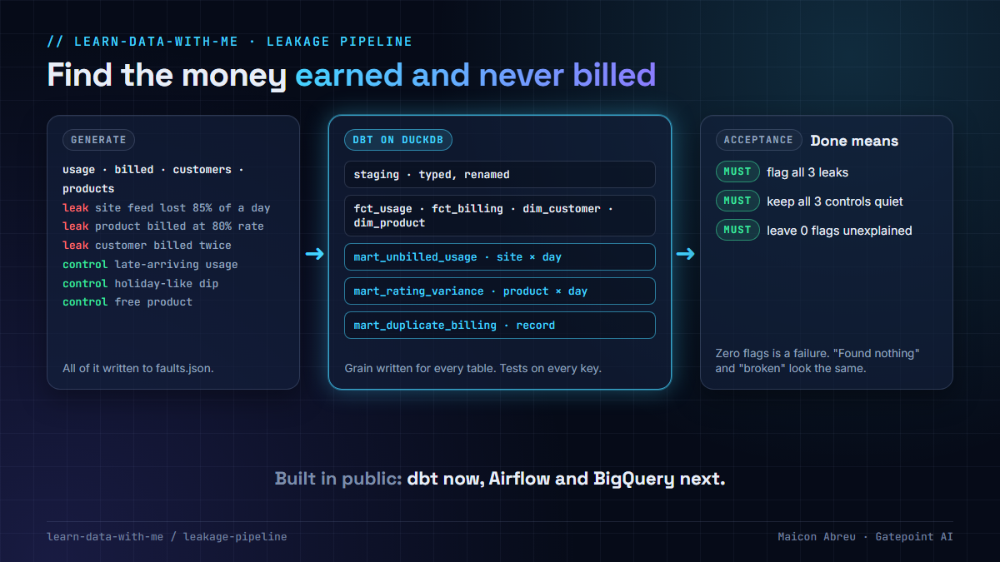

# Leakage pipeline

**A revenue-assurance pipeline, built in public: synthetic telecom usage and billing data in, a dbt star schema in the middle, and reconciliation marts out that find money earned and never billed.**

> **Status, November 2026:** foundation in place (the data generator, the spec and the acceptance check). The dbt models are being built now. Airflow orchestration, BigQuery and Terraform come next.



## Why this project

For 20 years my job has been finding revenue that should have been collected and wasn't. The control behind it is always a reconciliation: what the network carried against what billing charged. This project builds that control the way a modern data team would: as a tested dbt model, with an acceptance check that proves it finds what it should.

## How it works

```
generate/generate.py  ──►  data/*.csv + faults.json
                                 │
dbt/ (DuckDB)   staging ─► fct_usage, fct_billing, dim_customer, dim_product
                                 └─► mart_unbilled_usage · mart_rating_variance · mart_duplicate_billing
                                 │
check/acceptance.py   reads faults.json and the marts ─► PASS / FAIL
```

1. **The generator** writes customers, products, usage records and bill lines for 30 days, deterministically. It plants three leaks (a site whose billing feed lost most of a day, a product billed at the wrong rate, a customer billed twice) and three controls that must **not** be flagged (usage that arrived two days late, a day when every site's volume fell like a holiday, a free product that is never billed by design). It writes all of them to `faults.json`.
2. **The dbt project** builds a small star schema and three reconciliation marts. [`SPEC.md`](SPEC.md) is the contract: the grain of every table, the columns of every mart, and the tests every build runs.
3. **The acceptance check** passes only if every planted leak is flagged, every control stays quiet, and no flag is left unexplained. Finding nothing counts as a failure.

## Run it

```bash
# 1. data (Python standard library only)
python generate/generate.py

# 2. models (needs dbt-duckdb: pip install dbt-duckdb)
cd dbt
cp profiles.yml.example profiles.yml
dbt build
cd ..

# 3. the check
python check/acceptance.py
```

## What it will show, step by step

| Step | Skill | Status |
|---|---|---|
| Synthetic data with planted leaks and controls | Test data design | ✅ |
| Spec and acceptance check | Data contracts, fail-closed testing | ✅ |
| Staging, facts and dimensions with tests | dbt, dimensional modelling | in progress |
| Incremental usage with a lookback for late data | dbt incremental models | next |
| Customer history (slowly changing dimension) | dbt snapshots | next |
| Daily orchestration with retries and backfills | Airflow | planned |
| Raw data in BigQuery, created with Terraform | GCP, infrastructure as code | planned |

## Related lessons

- [01 · Missing data raises no error](../01-missing-data-raises-no-error/): why the reconciliation runs per site and per day.
- [02 · Grain first](../02-grain-first/): why every mart states its grain.
- [06 · Re-runnable by design](../06-re-runnable-by-design/): why loads replace instead of append.
